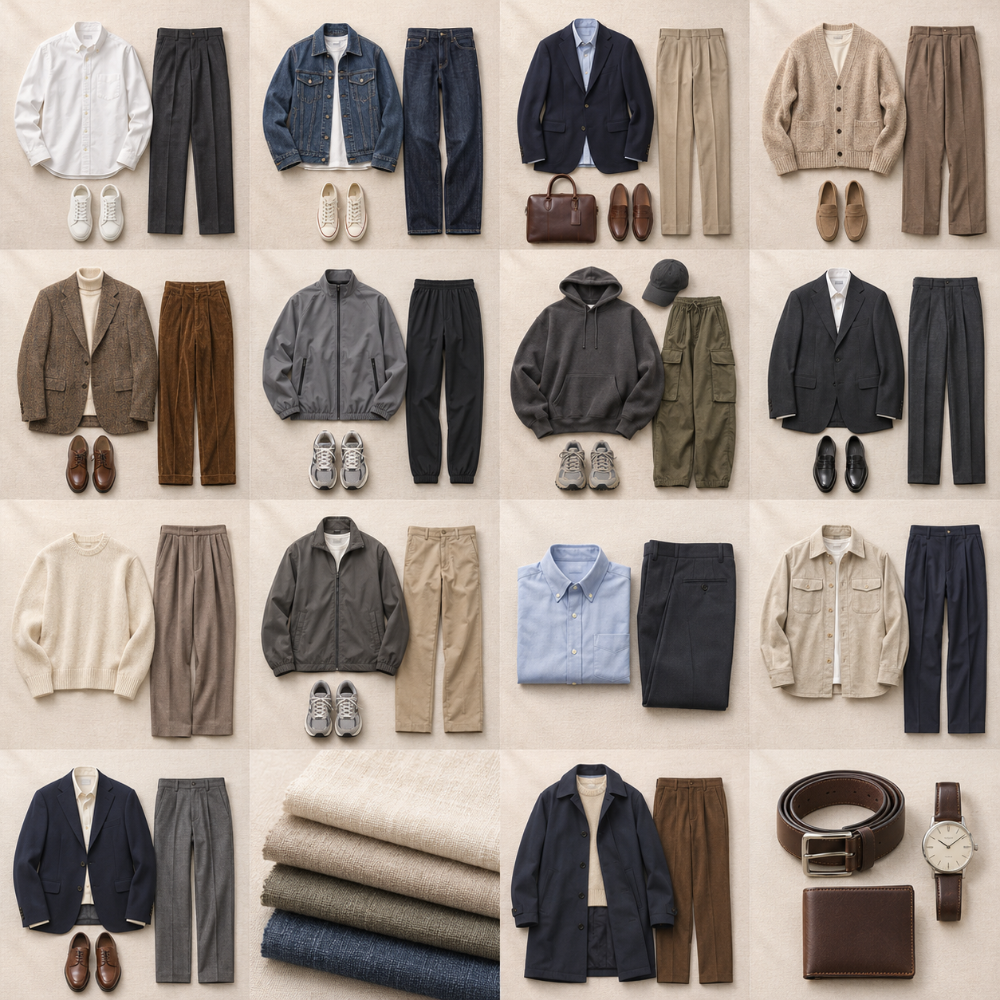
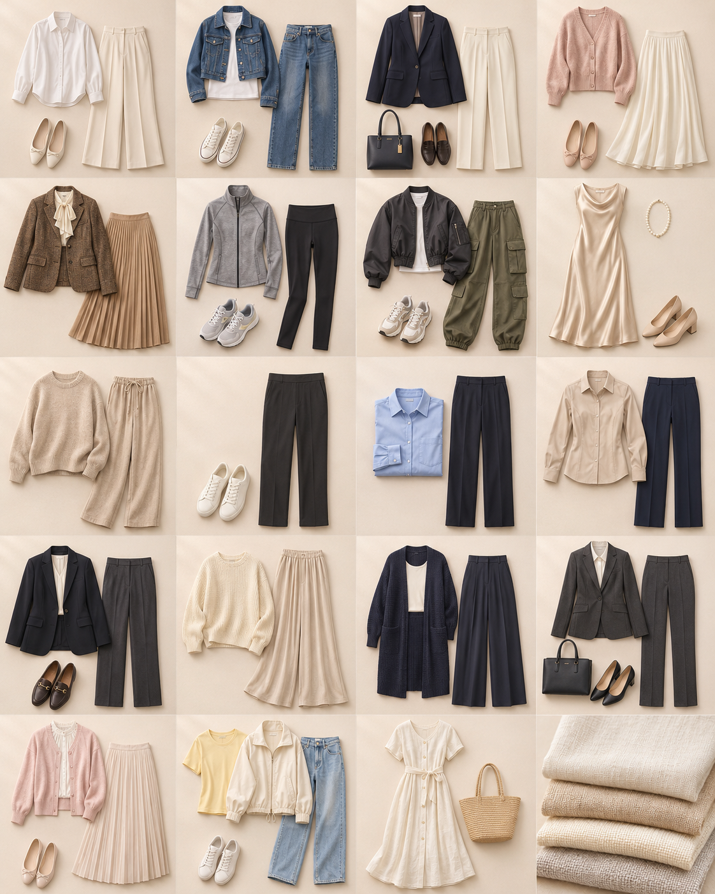

# 用户性别与穿搭偏好图片

2026-11-04：Onboarding「心动穿搭」与设置「了解我」统一按用户本人性别展示参考图片。助理角色及界面配色独立，不参与男／女装图集选择。这些图片是偏好示意，不代表个人衣橱库存或试穿结果。

## 素材及映射

使用内置 image_gen 分别生成两套平铺摄影图集，保留原浅米色背景、自然织物质感和柔和阴影。原素材保留，新增文件：

- 男装：[`preference-fashion-male-v4.png`](../stylist/static/assets/preference-fashion-male-v4.png)，1254×1254，4列4行。
- 女装：[`preference-fashion-female-v4.png`](../stylist/static/assets/preference-fashion-female-v4.png)，1122×1402，4列5行。
- 完整生成提示词：[`preference-fashion-v4.prompts.json`](../stylist/static/assets/preference-fashion-v4.prompts.json)。使用内置工具，未调用备用CLI。

两处均通过`stylist/static/fashion-preferences.js`确定图片、位置和可用标签，避免各自维护不同映射。未设置性别的旧资料不猜性别、不显示带性别的参考图；不展示性别专属标签。

| 图格索引 从0开始 | 标签 | 适用范围 |
| --- | --- | --- |
| 0–7 | 简约、休闲、通勤、温柔、复古、运动、街头、优雅 | 男女各有对应服装图 |
| 8 | 舒适自在 | 男性显示 |
| 9 | 方便走动 | 男性显示 |
| 10 | 容易打理 | 男性显示 |
| 11 | 合身自然 | 男性显示 |
| 12 | 适合场合 | 男性显示 |
| 13 | 轻松舒适 | 女性显示 |
| 14 | 显瘦遮肉 | 女性显示 |
| 15 | 职业干练 | 女性显示 |
| 16 | 温柔甜美 | 女性显示 |
| 17 | 活力阳光 | 女性显示 |

男性显示原五项优先项，女性只显示新五项，两组各五项；每组仍最多选三项。原风格值和选择规则不变。账号资料更新或修改用户性别后，设置重新打开使用当前资料；头像、助理性别和主题变化不会改变用户标签范围。

## 保存与Agent上下文

`CompanionProfile.dressing_priorities`接受新增五个值，仍最多三项；旧值继续兼容。保存字段沿用现有资料API，不新增可由客户端伪造的性别标签字段。

服务端在规划和生成上下文顶层派生`dressing_priority_tags`，与`companion_profile`并列：

```json
{
  "dressing_priority_tags": [
    {"label": "显瘦遮肉", "gender_type": "female", "applicable_gender": "female"},
    {"label": "职业干练", "gender_type": "female", "applicable_gender": "female"}
  ]
}
```

`gender_type`取用户本人性别，对应male／female／unspecified；`applicable_gender`取标签范围male／female／unisex。原有五项在当前界面为男性标签，新五项为女性标签；旧已有衣物优先／尝试新风格继续兼容为unisex。

两组标签只在用户本人对应性别下生效；用户改为男性或性别未知时，Agent有效偏好排除此类标签，不自动擦除已保存资料。生成阶段当轮明确男／女装时，排除另一组专属项。为他人搭配不套用本人偏好，当前请求、真实候选、天气、禁穿及局部冻结优先。

「显瘦遮肉」仅表达用户主动选择的视觉轮廓／覆盖度偏好，不推断身材或体重，不作减重、疗效或永久改变承诺。

## 验证证据

- Python必要回归71项通过：身份、系统配色、六人格、题库校验与存储；覆盖新增枚举、最多三项、服务端派生标签、显式男装排除、资料持久化及账号隔离。后续男女各五项规则已补对称类型排除验证。
- 前端31项通过：偏好、称呼设置、手记；含女性五项保存、助理性别独立、同账号用户性别刷新及未知性别处理。
- Chrome模拟`check_gender_fashion.cjs`通过：男用户＋女助理、女用户＋男助理的两处图集、各五项标签数量、三项上限、资料更新与320／393px及844×390横屏边界。
- 新增5组10轮女性标签可执行题库，完成静态／模拟校验，未执行真实文字模型评审。PNG及缩略图已目视核对。
- 不含真实账号资料写入、真实衣橱、试穿或真机验收。前后红圈截图见[UI-018](UI_CHANGELOG.html#ui-018)。


完整生成素材分别展示：

### 男装图集



### 女装图集


