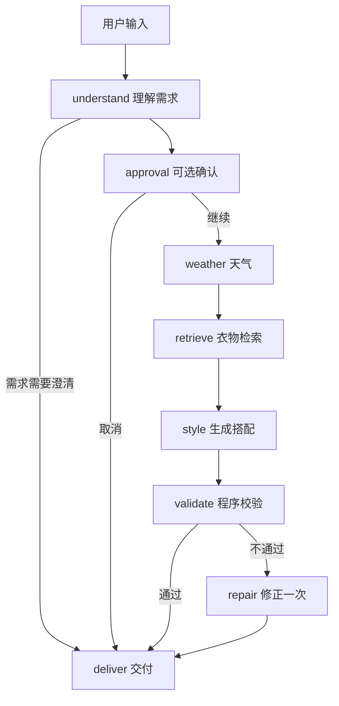

# 用衣衣项目理解 LangGraph

衣衣仍然只有一个主 Agent，模型仍负责需求整理和搭配。LangGraph 接管步骤之间的编排、检查点、暂停和恢复，不需要再增加多个角色或更换模型。实现入口是 `stylist/engine.py`。

## 六个入门概念

| 概念 | 可以怎样理解 | 在衣衣中的对应 |
| --- | --- | --- |
| State | 本轮执行记录 | 当前会话、结构化需求、天气、候选、搭配草稿 |
| Node | 一个工作步骤 | understand、weather、retrieve、style、validate |
| Edge | 下一步走哪里 | 校验通过就交付，未通过则修正一次 |
| Checkpointer | 把每一步的结果存起来 | 本地 SQLite，部署使用 PostgreSQL |
| thread_id | 找回一次执行记录的标识 | 由服务端根据已验证账号和 request_id 哈希生成 |
| interrupt 和 Command | 暂停等人，再带着答案继续 | 可选的“先确认需求”，确认后才查天气和生成 |

不要把 checkpoint 当作持久化整个 Python 进程。它保存节点间的数据，不保存网络连接、正在等待的 HTTP 响应或任意代码行的执行位置。[官方持久化说明](https://docs.langchain.com/oss/python/langgraph/persistence)

## 实际流程



每个节点返回一份 State 更新，LangGraph 合并并写入检查点。选择 `durability="sync"`，让已完成步骤的检查点落盘后再继续下一步。比如在 style 中进程被杀死，恢复时重新执行 style，已经完成的 understand、weather、retrieve 不必重跑；仍可能再次产生一次模型费用。

重试和修正是两回事：临时超时、连接失败和部分限流/网关错误允许模型节点最多尝试两次；搭配不满足业务约束则走独立 repair 节点，最多修正一次。模型适配器原有的 JSON 格式修复也保留。鉴权失败、非法单品、付费操作不使用通用自动重试。

## 最小可运行示例

保存为本地示例文件，在本项目虚拟环境中运行。它不调用任何模型或收费接口。

```python
import asyncio
from typing import TypedDict
from langgraph.checkpoint.sqlite.aio import AsyncSqliteSaver
from langgraph.graph import StateGraph, START, END
from langgraph.types import interrupt, Command

class State(TypedDict, total=False):
    requirement: str
    approved: bool
    result: str

def approve(state: State):
    answer = interrupt({"requirement": state["requirement"]})
    return {"approved": answer is True}

def deliver(state: State):
    return {"result": "可以开始搭配" if state["approved"] else "已取消"}

async def main():
    builder = StateGraph(State)
    builder.add_node("approve", approve)
    builder.add_node("deliver", deliver)
    builder.add_edge(START, "approve")
    builder.add_edge("approve", "deliver")
    builder.add_edge("deliver", END)
    async with AsyncSqliteSaver.from_conn_string("demo-checkpoints.sqlite3") as saver:
        graph = builder.compile(checkpointer=saver)
        config = {"configurable": {"thread_id": "demo-only-1"}}
        paused = await graph.ainvoke({"requirement": "雨天通勤"}, config, durability="sync")
        print(paused["__interrupt__"])
        result = await graph.ainvoke(Command(resume=True), config, durability="sync")
        print(result["result"])

asyncio.run(main())
```

暂停后再次运行的是包含 interrupt 的节点，所以 interrupt 前不能放不可重复的写入或扣费。[官方暂停恢复说明](https://docs.langchain.com/oss/python/langgraph/interrupts)

## 当前项目怎样使用

本地更新 Python 后端或请求字段后，需要重启 `run-local.sh` 启动的服务，再刷新页面；该脚本默认不启用自动重载。仅刷新页面会加载新前端，但旧后端仍可能拒绝 `confirm_plan` 等新增字段并返回 422。重启后可用 `/health/ready` 及 `/openapi.json` 确认当前接口已加载。

- 普通对话默认沿用原体验。
- 勾选输入区“先确认需求”，先返回需求确认，点击确认或取消继续。
- 同一请求恢复必须携带完全相同的 ChatRequest 和 request_id；换一个 request_id 就是新任务。
- 前端将原请求保存在当前标签页的 sessionStorage；断线自动重连，刷新后从同一请求恢复。用户退出登录时清除本地待恢复请求。
- `GET /stylist-api/runs/{request_id}` 查看当前账号的任务状态与待执行节点。
- `POST /stylist-api/chat/approval` 接收 `{ "request": 原ChatRequest, "approved": true或false }`；服务端验证账号、请求摘要和会话版本，不接受客户端指定 owner。
- `/stylist-api/chat/stream` 的连接关闭不取消后台生成。运行中另一连接接入会复用本进程任务，或等待原实例释放执行权。
- 会话执行租约45秒、每10秒续租。进程异常死亡后，浏览器重连在租约到期后接管；数据库必须可用。PostgreSQL 下还持有每个执行的 advisory lock，避免存活但失去租约的旧实例与新实例同时写检查点。
- Bearer 只存在内存，不写入检查点。恢复需要用户提供有效登录态。关闭页面后旧实例仍会尽力完成任务；如果期间实例也死亡，本版需要页面重新打开/重连才触发恢复，没有独立后台调度器自动捞取无人订阅的任务。

付费试穿仍由 `ImageService` 单独处理。已有费用确认和 unknown 状态不能被 LangGraph 绕过，宕机后不能自动重复提交。长时间确认前的天气、价格和可用性也不能永久当作有效证据；当前需求确认放在这些查询之前，确认后重新查询。
