# 爱搭衣橱界面变更记录

记录爱搭衣橱界面的逐项变化，作为后续持续追加的变更台账。更新日期：2026-11-04。截图来自本地 App H5及独立引导预览，使用手机或桌面模拟视口；红圈标记本条修改位置。账号、签到和历史数据均为模拟，不包含真实用户资料；前后图按条目标注，补拍另行说明。

## 持续维护规则

执行顺序：先截修改前页面并圈出实际目标 → 登记需求与待实现状态 → 修改代码 → 截修改后页面并补充验证。删除项在前图圈出被删文字，后图不圈无关文案；补拍需明确标注。

后续每次用户要求修改界面或文案，同轮新增一条记录：日期、编号、位置、修改前后、实现状态、验证情况和红圈截图。同一功能的过程调整合并到最终条目，不单列中间方案；按用户要求删除冗余项后连续编号。截图使用本地模拟数据，避免真实账号和用户图片。

## 变更索引

| 编号 | 日期 | 修改项 | 状态 |
| --- | --- | --- | --- |
| UI-001 | 2026-11-04 | 首页城市定位入口 | 本地已实现 |
| UI-002 | 2026-11-04 | 签到按钮右对齐 | 本地已实现 |
| UI-003 | 2026-11-04 | 品牌统一更名 | 本地已实现 |
| UI-004 | 2026-11-04 | 首页对话入口命名 | 本地已实现 |
| UI-005 | 2026-11-04 | 历史弹窗与相关文案统一 | 本地已实现 |
| UI-006 | 2026-11-04 | 试穿形象移除已创建文字 | 本地已实现 |
| UI-007 | 2026-11-04 | Onboarding最后一页聊天入口文案 | 本地已实现 |
| UI-008 | 2026-11-04 | Onboarding仅删除助手昵称 | 本地已实现 |
| UI-009 | 2026-11-04 | Onboarding定位六种状态截图 | H5模拟证据已补齐 |
| UI-010 | 2026-11-04 | 伙伴名字留空默认衣衣 | 本地已实现 |
| UI-011 | 2026-11-04 | App H5统一称呼为助理 | 本地已实现 |
| UI-012 | 2026-11-04 | 男女助理默认名提示语气 | 本地已实现 |
| UI-013 | 2026-11-04 | 登录页移除小笺署名 | 本地已实现 |
| UI-014 | 2026-11-04 | 验证码页引导语优化 | 本地已实现 |
| UI-015 | 2026-11-04 | Agent输入框底部说明优化 | 本地已实现 |
| UI-016 | 2026-11-04 | Onboarding前两步不可跳过 | 本地已实现 |
| UI-017 | 2026-11-04 | 登录与Onboarding对话卡正文间距清理 | 本地已实现 |
| UI-018 | 2026-11-04 | 用户性别图集与差异标签 | 本地已实现 |
| UI-019 | 2026-11-04 | 首页单行助理提示与城市天气 | 本地已实现 |

## UI-001 首页城市定位入口

- 日期：2026-11-04
- 状态：本地已实现
- 修改前：首页右上角没有城市定位入口。
- 修改后：首页右上角增加定位图标和城市名称；未选城市显示「定位城市」。点击后复用定位、城市确认和手动选城流程。
- 验证与边界：仅点击后请求定位；拒绝或超时保留手动选城，不自动发送对话。

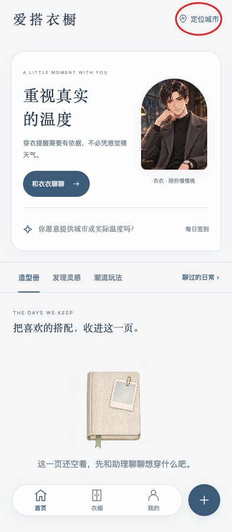

## UI-002 签到按钮右对齐

- 日期：2026-11-04
- 状态：本地已实现
- 修改前：用户反馈签到按钮没有贴齐所在行右侧。
- 修改后：「每日签到」和「已签到」均固定右对齐，保持原签到入口。
- 验证与边界：320、393、1440px两种状态的按钮右边缘与所在行一致；两种状态均使用模拟数据展示。

已签到状态同样靠右：

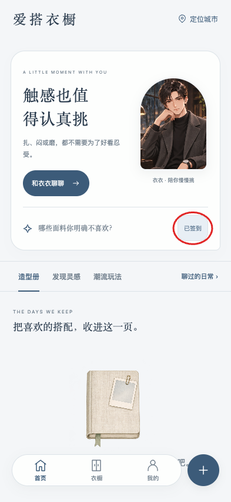

## UI-003 品牌统一更名

- 日期：2026-11-04
- 状态：本地已实现
- 修改前：页面品牌为「衣间」。
- 修改后：所有原品牌文字统一为「爱搭衣橱」，同步页面标题、登录引导、提示及无障碍名称。
- 验证与边界：助理昵称「衣衣」保留；技术路径与design=yijian保留兼容；历史截图内文字未重绘。320、393、1440px首页品牌与城市入口无重叠。

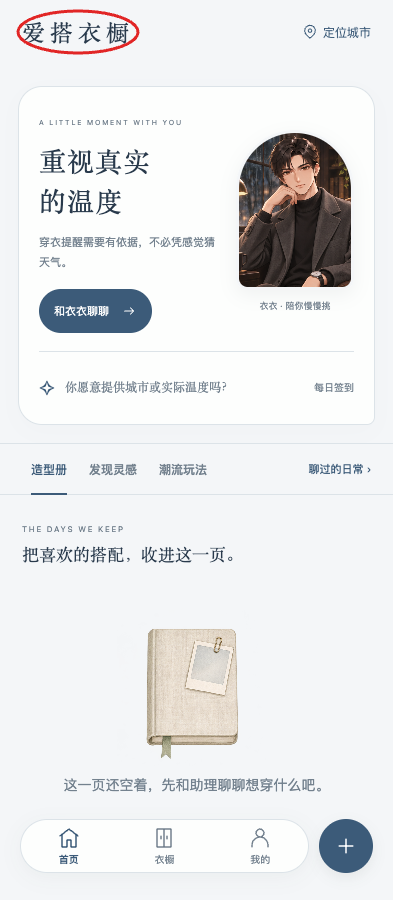

## UI-004 首页对话入口命名

- 日期：2026-11-04
- 状态：本地已实现
- 修改前：首页入口显示「聊天记录」。
- 修改后：首页入口改为「聊过的日常」。
- 验证与边界：保留原历史查询和会话恢复入口，无障碍名称同步更新。

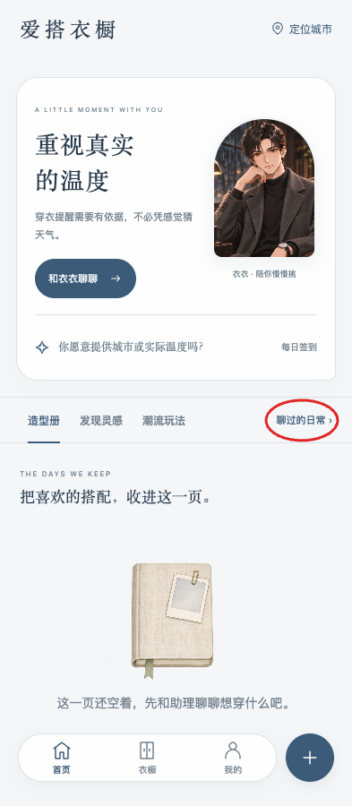

## UI-005 历史弹窗与相关文案统一

- 日期：2026-11-04
- 状态：本地已实现
- 修改前：历史弹窗标题及相关提示为「历史对话」。
- 修改后：弹窗标题、相关入口提示、无障碍名称及加载／空态中的原文案统一为「聊过的日常」。
- 验证与边界：独立Agent和App共用文案已同步；截图为模拟账号的空列表。

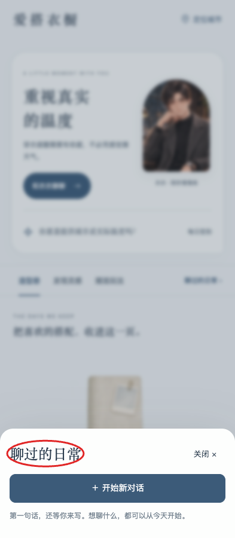

## UI-006 试穿形象移除已创建文字

- 日期：2026-11-04
- 状态：本地已实现
- 修改前：「我的试穿形象」标题下显示「已创建」。
- 修改后：已创建形象不再展示此状态行，也不保留其占位；说明与查看入口保留。
- 验证与边界：Chrome模拟已创建状态确认文字清空且状态行隐藏，切换为未创建状态后提示仍可见。图中使用项目角色素材代替私人形象；修改前截图为临时恢复原代码后的补拍，红圈准确标注「已创建」；修改后不圈说明文字。

修改前（恢复原状态补拍）：

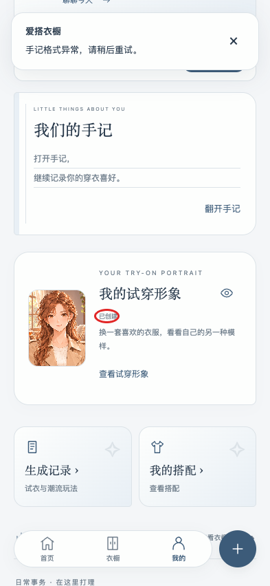

修改后：

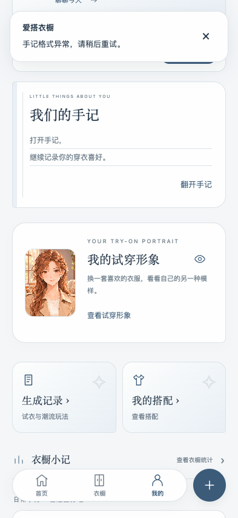

## UI-007 Onboarding最后一页聊天入口文案

- 日期：2026-11-04
- 状态：本地已实现；先截图、登记，再修改并补后图。
- 修改前：和伙伴直接聊聊。
- 目标文案：和我直接聊一聊。
- 边界：仅修改按钮标题，保留进入聊天及保存流程。

修改后（Chrome预览核对文案及红圈通过）：

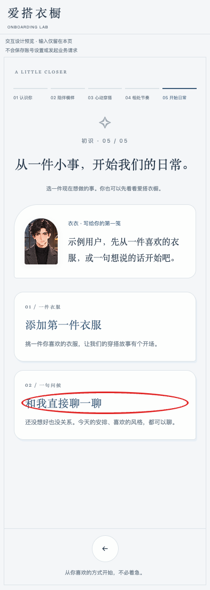

## UI-008 Onboarding仅删除助手昵称

已同步移除正文顶部遗留的8px margin，正文margin为0，卡片padding保留。

- 日期：2026-11-04
- 状态：本地已实现，五步核对通过。
- 修改前：对话卡展示「衣衣／助手昵称」和引导语。
- 修改后：仅删除昵称small元素，保留对话卡和每步原引导语，其余不变。
- 截图说明：前图为恢复原昵称元素后的补拍，红圈仅标注助手昵称；后图为当前实际页面，五步对话均保留。
- 验证：Chrome五步均确认卡片及正文存在、昵称元素不存在；纯预览资料，无真实账号保存。

### 第1步 认识你

修改前（原昵称补拍）：

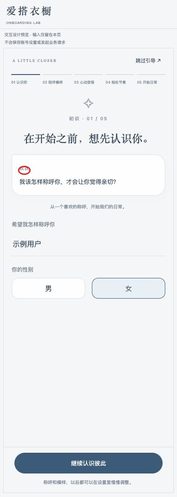

修改后（保留对话）：

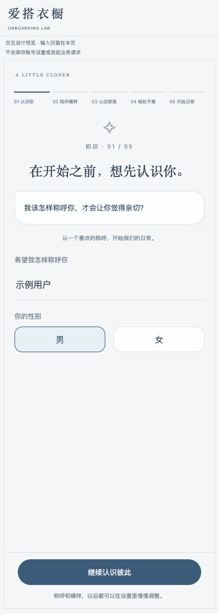

### 第2步 陪伴模样

修改前（原昵称补拍）：

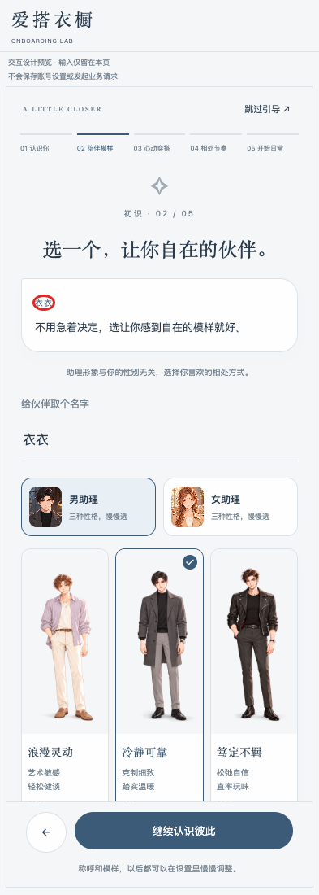

修改后（保留对话）：

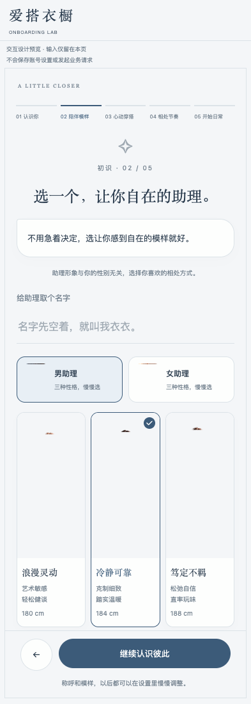

### 第3步 穿衣习惯

修改前（原昵称补拍）：

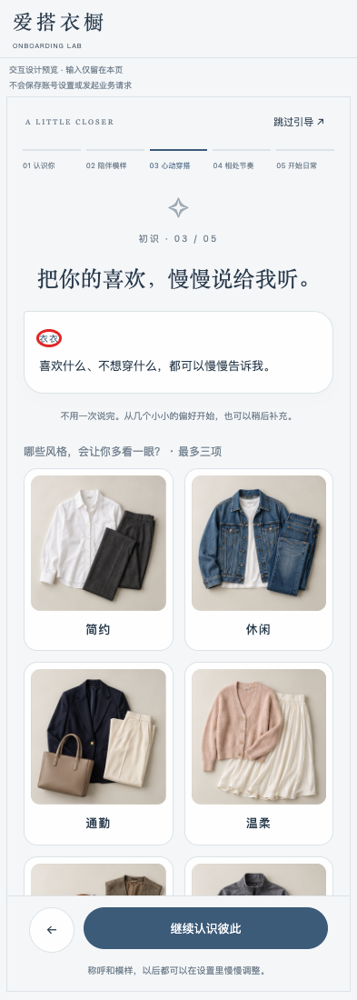

修改后（保留对话）：

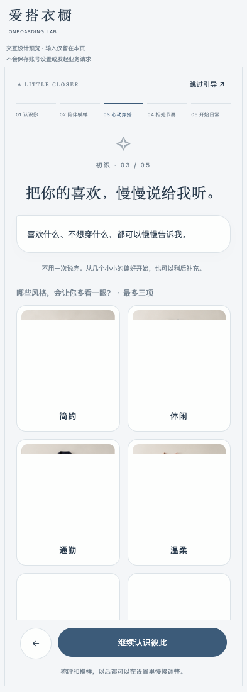

### 第4步 相处节奏

修改前（原昵称补拍）：

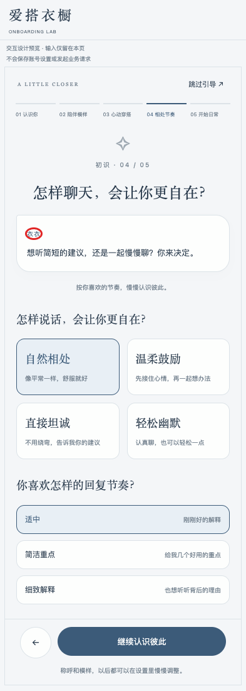

修改后（保留对话）：

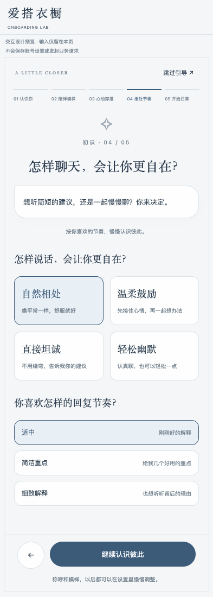

### 第5步 第一件小事

修改前（原昵称补拍）：

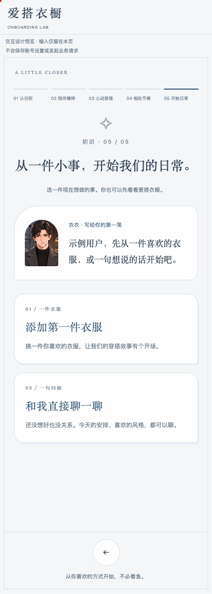

修改后（保留对话）：

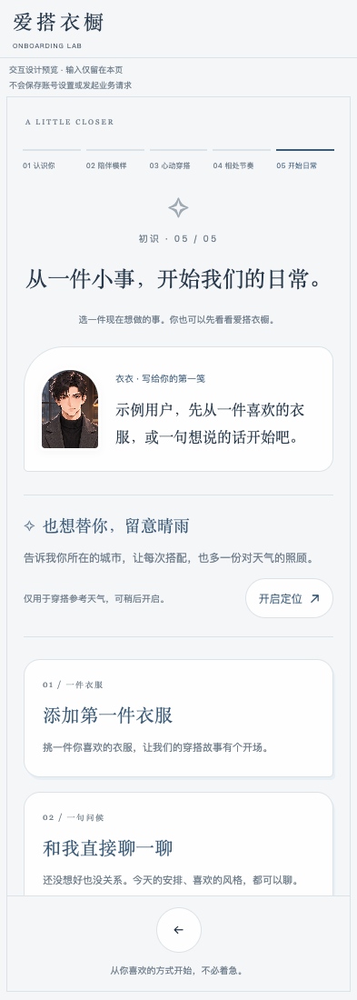

## UI-009 Onboarding定位状态截图

- 日期：2026-11-04
- 状态：当前H5的六种状态已截图，红圈标注入口或状态反馈。
- 范围：补充当前H5 Onboarding的定位反馈截图，不修改产品代码。截图使用393×1100视口、示例资料、模拟浏览器定位与模拟城市解析；不使用真实账号或真实GPS，不展示真实系统权限弹窗，也不是iOS原生截图。系统允许定位、拿到位置、城市确认是不同阶段，只有城市确认后才保存本次选择。
- 验证：`scripts/capture_onboarding_location_states.cjs`通过，包含未点击零定位、确认前无城市保存、确认后回显，以及拒绝和超时分支；本轮无业务代码变更。

### 状态1 未开启

- 页面反馈：仅用于穿搭参考天气，可稍后开启。
- 说明：进入第五步时不会请求定位。红圈标注唯一的「开启定位」按钮。

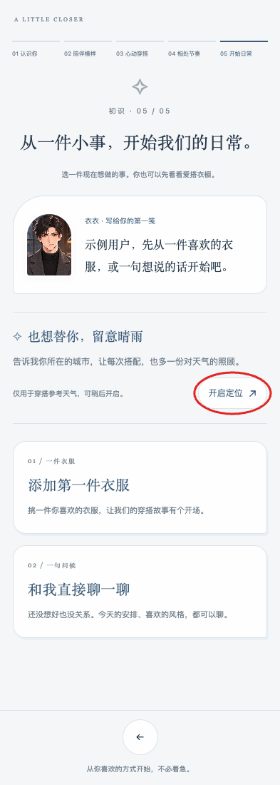

### 状态2 等待授权或定位

- 页面反馈：请允许访问位置；不想开启也可以手动选择城市。
- 说明：点击后请求浏览器定位，等待定位回调。当前页面不单独展示「权限已允许」状态；此图是应用内等待状态，不是系统权限弹窗。

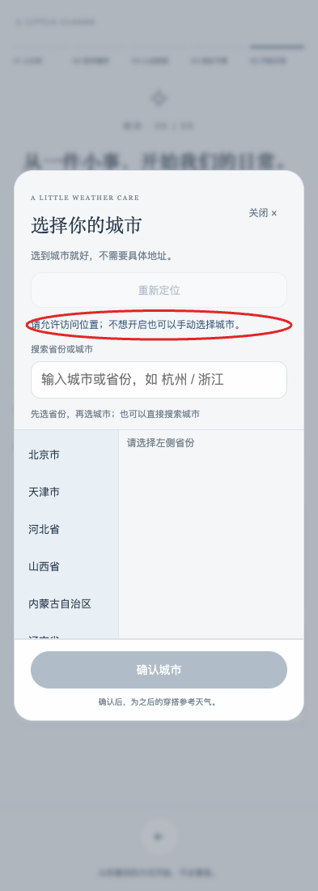

### 状态3 定位成功 待确认城市

- 页面反馈：找到上海市啦，请确认后使用。
- 说明：已收到模拟坐标并完成模拟城市解析，此时尚未保存城市；点击「确认城市」才使用。

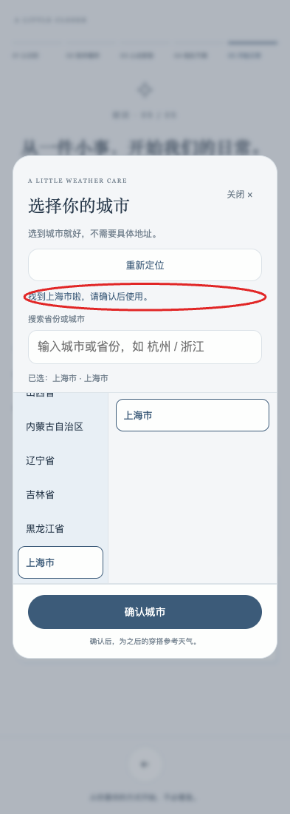

### 状态4 城市已确认

- 页面反馈：已选择上海市，之后的穿搭会按需参考这里的天气。
- 说明：用户确认后关闭弹窗、保存城市到当前会话并更新小笺反馈。当前按钮仍为「开启定位」，用于再次定位；「已开启 · 城市」仅是此前建议，尚未实现。

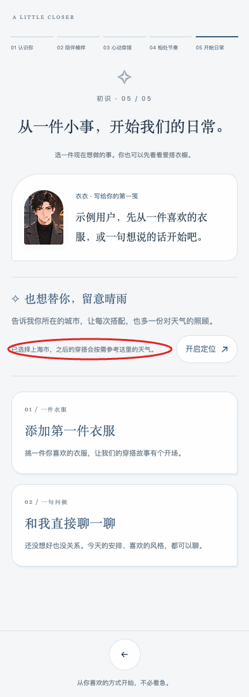

### 状态5 用户拒绝授权

- 页面反馈：定位未开启也没关系，手动选一座城市吧。
- 说明：拒绝定位不阻挡使用，可以在弹窗手动选城或关闭。

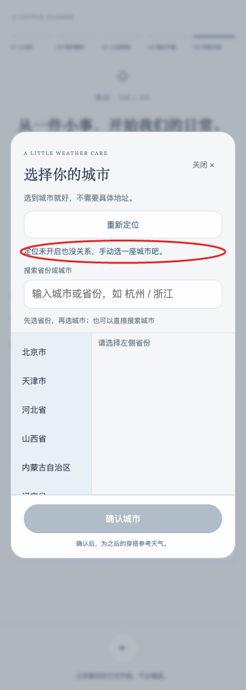

### 状态6 定位超时

- 页面反馈：定位等得有点久，可以再试一次，或手动选择。
- 说明：可重新定位、手动选城或关闭；超时不显示定位成功。

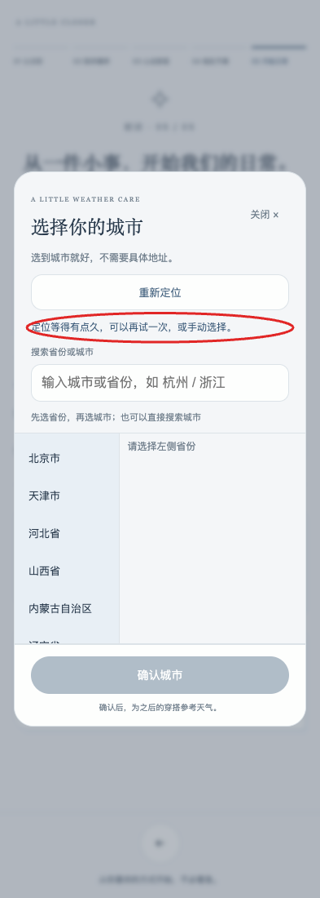

## UI-010 Onboarding伙伴名字留空默认衣衣

- 日期：2026-11-04
- 状态：本地已实现；先截原输入框、登记，再修改及补后图。
- 需求：伙伴名字没填时使用「衣衣」，不阻止继续；有值时使用去首尾空白后的自定义名。具体角色仍必选，不更改其他资料要求。

- 修改后：伙伴名字输入框提示「衣衣（留空使用默认名字）」，不再必填；空值及纯空格使用衣衣，非空名字去首尾空格；邀请署名、通知与正式保存统一默认值。角色必选、用户称呼及性别要求保留。
- 验证：空值／纯空格／自定义名三组真实页面模拟通过，覆盖角色必选、继续、最终署名、提交字段及保存失败不丢草稿；定位模拟回归通过。未保存真实账号。

修改前：

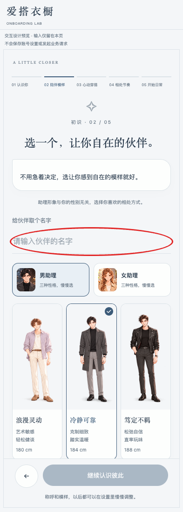

修改后：

## UI-011 App H5统一称呼为助理

- 日期：2026-11-04
- 状态：本地已实现；先拍四组前图、登记，再替换并补四组后图。
- 用户要求：所有App H5的「伙伴」文案统一为「助理」，列出修改位置。
- 范围：界面、提示、无障碍、相关预览与对照页，以及App复用的展示模块；不修改用户自定义昵称、接口字段及角色ID。

- 结果：19个H5页面与脚本共90处替换，含共享展示模块、无障碍和相关预览；小伙伴统一为助理，避免产生小助理。静态源码无剩余「伙伴」；不改用户保存的昵称或历史消息，历史截图不重绘。默认名、定位及4组截图流程模拟通过。

### 主要位置与文案

| 位置 | 修改前 | 修改后 |
| --- | --- | --- |
| Onboarding第二步标题 | 选一个，让你自在的伙伴。 | 选一个，让你自在的助理。 |
| Onboarding名字标签 | 给伙伴取个名字 | 给助理取个名字 |
| 设置入口说明 | 你的称呼与性别 · 伙伴名字与模样 | 你的称呼与性别 · 助理名字与模样 |
| 首页空态 | 这一页还空着，先和伙伴聊聊想穿什么吧。 | 这一页还空着，先和助理聊聊想穿什么吧。 |
| 搭配服务入口 | 和伙伴聊聊搭配 | 和助理聊聊搭配 |
| 称呼与形象说明 | 你的称呼，伙伴的模样，都由你来决定。 | 你的称呼，助理的模样，都由你来决定。 |
| 资料读取失败 | 暂时没能读取伙伴资料，请稍后重试。 | 暂时没能读取助理资料，请稍后重试。 |
| Agent欢迎语 | 你的日常搭配小伙伴／日常搭配伙伴 | 你的日常搭配助理 |
| 头像与小笺无障碍 | 搭配伙伴／我的日常与伙伴小笺 | 搭配助理／我的日常与助理小笺 |
| 首次使用预览 | 预览伙伴／伙伴的名字／跟随伙伴／男伙伴／女伙伴 | 预览助理／助理的名字／跟随助理／男助理／女助理 |

### 全部修改文件

| 文件 | 位置 | 替换处数 |
| --- | --- | --- |
| `stylist/static/agent-comparison.html` | Agent对比页说明 | 1 |
| `stylist/static/index.html` | 独立Agent欢迎语 | 1 |
| `stylist/static/design-overview.html` | 设计总览与人物说明 | 5 |
| `stylist/static/system-color-study.html` | 系统色对照中的内嵌快照文案 | 4 |
| `stylist/static/companion-strategy.html` | 陪伴方案说明 | 6 |
| `stylist/static/appearance.js` | 男女主题欢迎语 | 2 |
| `stylist/static/companion-settings.js` | 称呼形象说明及校验提示 | 2 |
| `stylist/static/companion-preview.html` | 角色预览说明 | 2 |
| `stylist/static/closet-app/yijian.js` | 个人中心小笺及头像无障碍名称 | 3 |
| `stylist/static/closet-app/agent-fragment.html` | App内嵌Agent欢迎语 | 1 |
| `stylist/static/closet-app/first-run.js` | 首次资料读取失败提示 | 1 |
| `stylist/static/closet-app/app.js` | 首页空态、设置说明、搭配入口 | 3 |
| `stylist/static/closet-app/first-visit/index.html` | 首次使用预览设置标签 | 3 |
| `stylist/static/closet-app/first-visit/app.js` | 男女助理选项及头像说明 | 4 |
| `stylist/static/closet-app/comparison/index.html` | 登录引导与版本对照说明 | 29 |
| `stylist/static/closet-app/comparison/evolution/index.html` | 产品演进对照文案 | 17 |
| `stylist/static/closet-app/onboarding/index.html` | Onboarding流程概述 | 1 |
| `stylist/static/closet-app/onboarding/legacy.js` | 旧引导演示角色文案 | 1 |
| `stylist/static/closet-app/onboarding/app.js` | Onboarding标题、名字标签、演示反馈及校验 | 4 |

### Onboarding前后截图

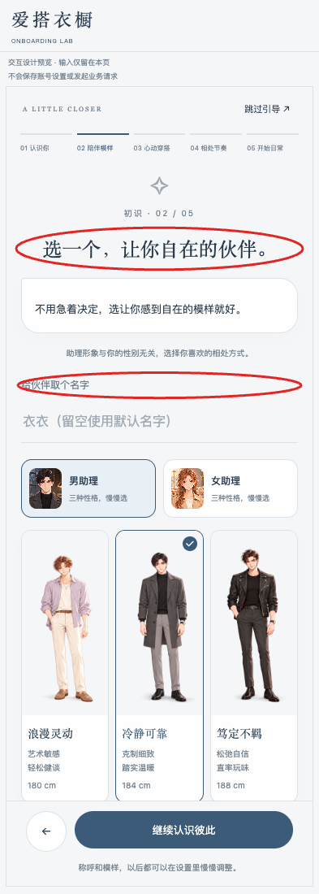

### 设置入口前后截图

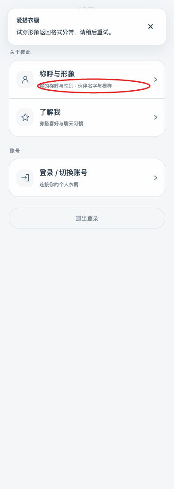

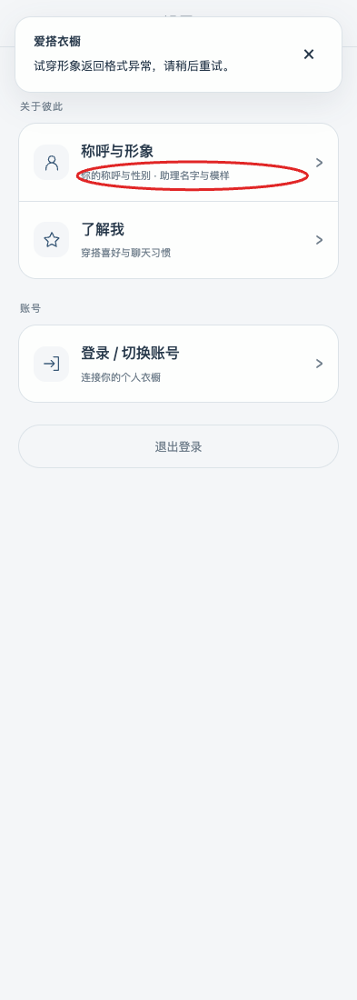

### 称呼与形象前后截图

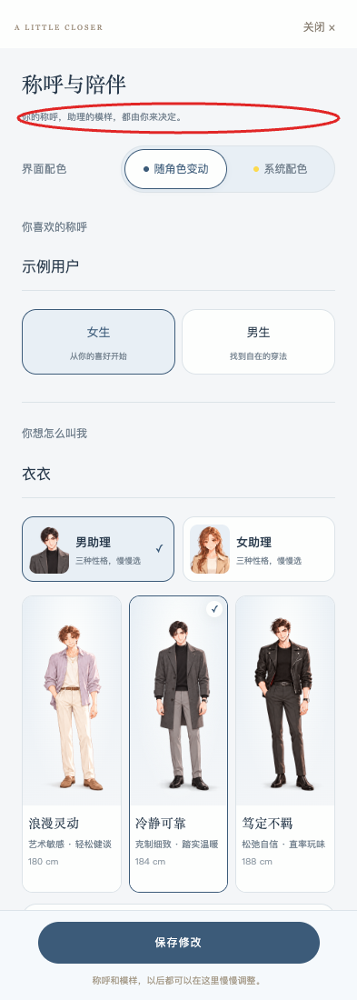

### 首次使用预览前后截图

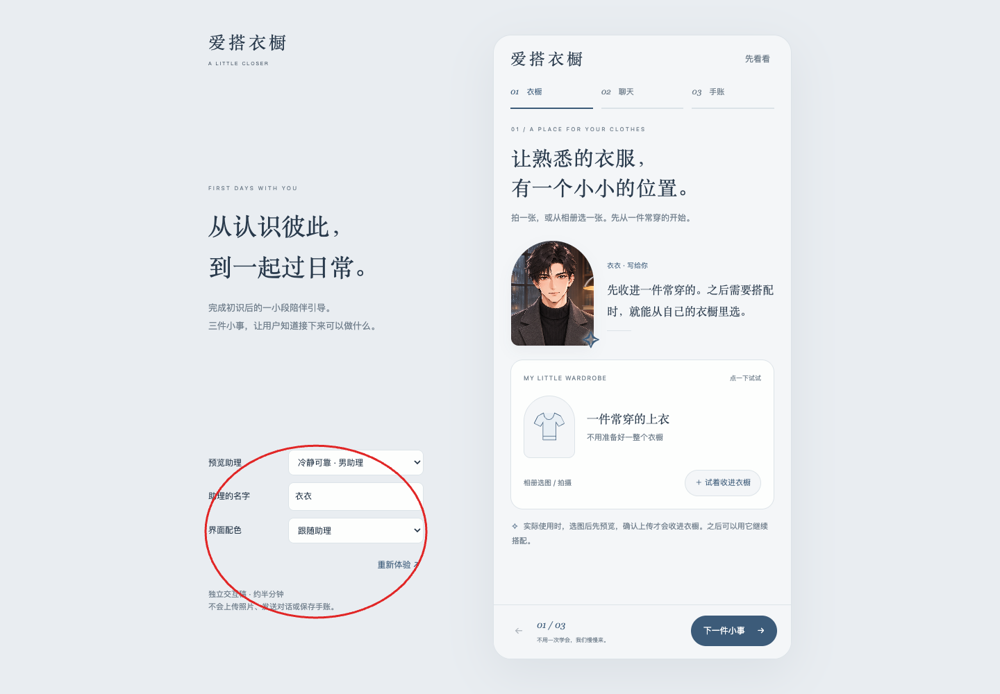

## UI-012 助理默认名字提示改为男女差异语气

- 日期：2026-11-04
- 状态：本地已实现；先截前图登记，再修改并拍男女两组后图。
- 用户要求：默认名字提示偏乙游风，男女助理表达不同，传达留空就叫衣衣。
- 文案：男助理「名字先空着，就叫我衣衣。」；女助理「留白也好，先叫我衣衣吧。」。跟随助理分组，不根据用户性别切换，不改变默认值规则。

- 验证：切换男／女助理分组时提示同步变化，与用户性别无关；320／393px提示完整显示，切组保留自定义名。空值、纯空格、自定义名的显示与模拟保存回归通过。

修改前：

修改后（男助理）：

修改后（女助理）：

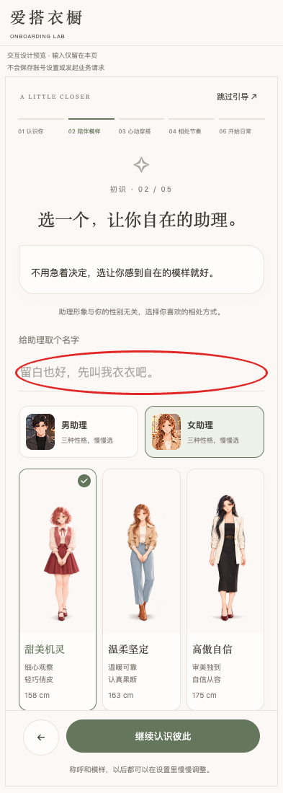

## UI-013 登录页移除小笺署名

已同步移除正文顶部遗留的8px margin，正文margin为0，卡片padding保留。

- 日期：2026-11-04
- 状态：本地已实现。
- 修改前：卡片顶部展示「衣衣的小笺」署名，下方为两句欢迎正文。
- 修改后：仅移除署名small元素，保留卡片及「很高兴，在这里遇见你。你的喜欢，我想慢慢了解。」正文，其他内容不变。
- 范围：正式App登录与独立预览共用模板；验证码及登录流程不变。
- 验证：320／393／1440px正式与预览页面均保留卡片、署名元素不存在；验证码切换及顶部返回保留号码通过，业务请求0次。

修改前（原署名补拍，红圈只标注署名）：

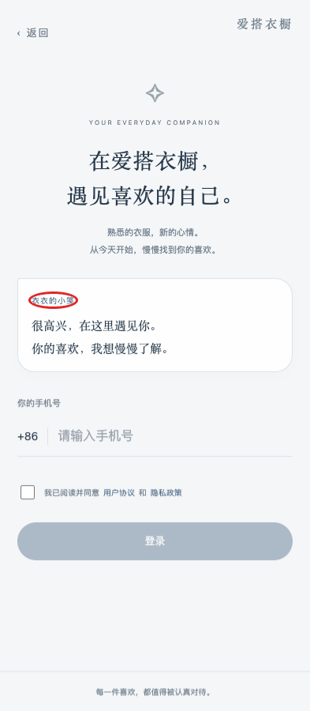

修改后：

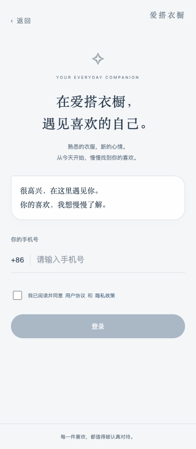

## UI-014 验证码页引导语优化

- 日期：2026-11-04
- 状态：本地已实现；先截前图登记，再替换说明并补后图。
- 修改前：请输入通过现有账号服务获取的验证码。
- 修改后目标：用一个小小的确认，开启我们的初见。
- 边界：仅改说明，不宣称已发送短信，保留验证码获取方式与校验流程。

- 验证：正式App验证码页使用与独立预览一致的初见引导语，Chrome进入验证码页并核对文案通过，业务请求0次；未发送真实短信或登录。

修改前：

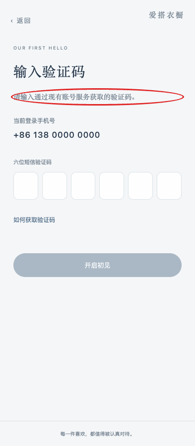

修改后：

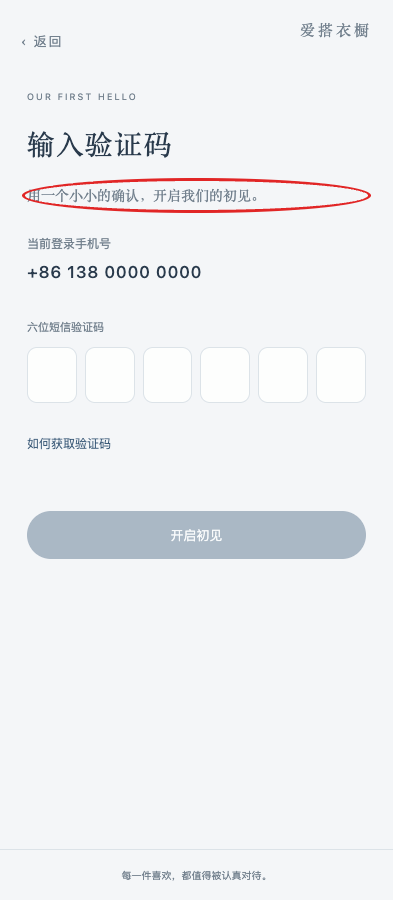

## UI-015 Agent输入框底部说明优化

- 日期：2026-11-04
- 状态：本地已实现；先拍前图登记，再改文案并补后图。
- 修改前：舒服自在，永远优先 · 试穿生图另行报价与确认。
- 修改后：慢慢聊，按你的喜欢来。
- 边界：仅调整展示文案，只改底部展示文案，业务确认规则不变。

- 验证：App内嵌Agent与独立Agent模板同步；320／393／1440px底部文案无横向溢出，打开聊天未产生对话请求。

修改前：

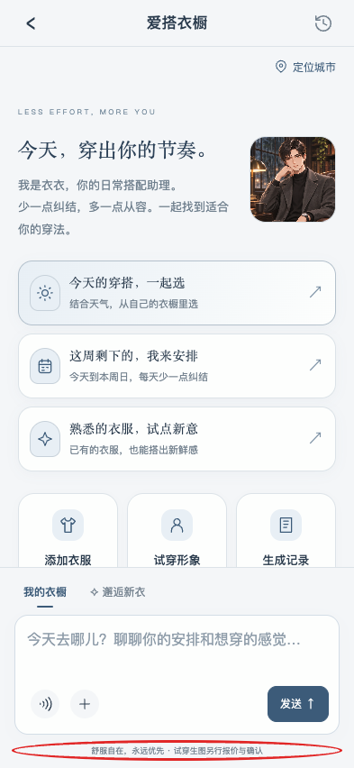

修改后：

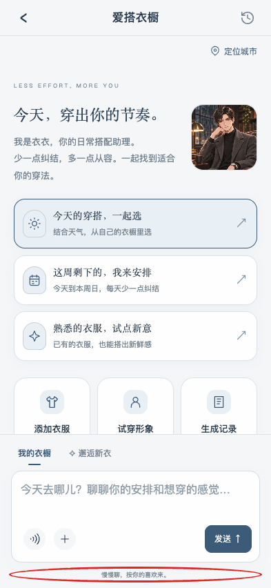

## UI-016 Onboarding前两步不可跳过

- 日期：2026-11-04
- 状态：本地已实现；先拍两步前图登记，再隐藏跳过入口及补后图。
- 用户要求：第一步和第二步不能跳过，不能展示跳过引导。
- 边界：填完、选好角色或从后续返回时也不展示；第三、四步保留可选跳过，最终页继续由功能入口进入。

- 验证：正式模式模拟和独立预览均覆盖前两步资料完整时隐藏、隐藏入口程序触发无保存、后续返回仍隐藏、第三步恢复可选入口；320／393px与844×390横屏检查通过，空白默认名回归通过。

### 第1步

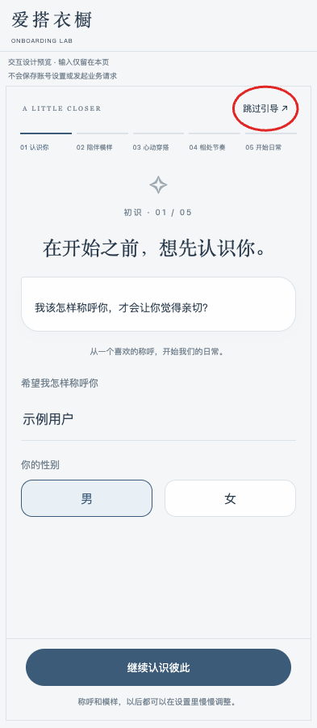

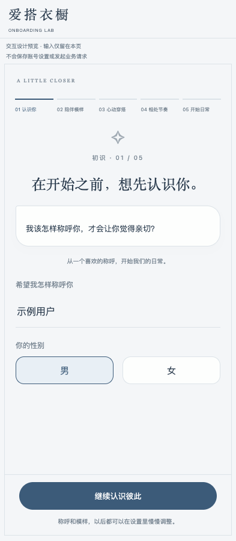

### 第2步

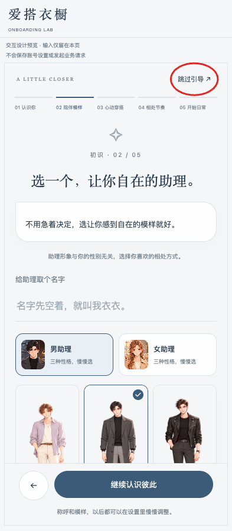

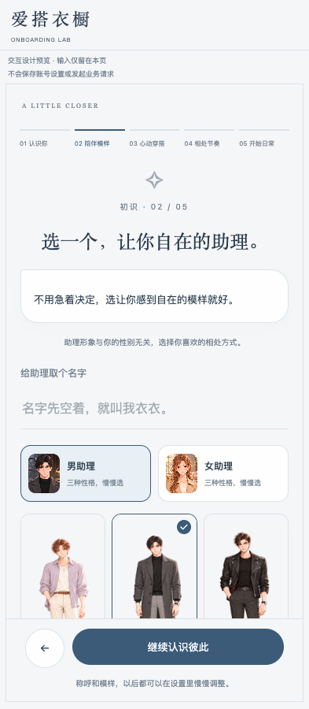

## UI-017 登录与Onboarding对话卡正文间距清理

- 日期：2026-11-04
- 状态：本地已实现。
- 修改位置：登录页`.login-letter p`、Onboarding `.closer-dialogue p`。
- 修改前：移除署名后，正文仍保留`margin: 8px 0 0`，顶部多一层空白。
- 修改后：正文统一`margin: 0`，上下留白由原卡片padding控制；卡片、正文及其他布局保留。
- 验证：320／393／1440px计算样式为0且无横向溢出，前后截图已核对。

### 登录页

修改前（红圈标注正文所在区域）：

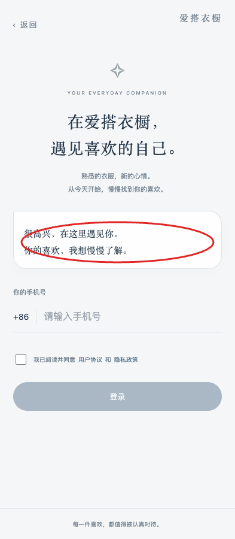

修改后：

### Onboarding

修改前（红圈标注正文所在区域）：

修改后：

## UI-018 用户性别图集与差异标签

- 日期：2026-11-04
- 状态：本地已实现。
- 范围：Onboarding「心动穿搭」与设置「了解我」，按用户本人的性别展示，与助理性别及配色独立。
- 男性五项：舒适自在、方便走动、容易打理、合身自然、适合场合。
- 女性五项：轻松舒适、显瘦遮肉、职业干练、温柔甜美、活力阳光。女性只展示这五项，不再叠加男性五项。
- 选择规则：两组各最多三项；八种穿搭风格保留，并分别使用纯男装／纯女装参考图。性别未知不猜类型，隐藏性别专属内容。
- Agent：服务端派生标签用户性别类型和适用范围；不适用于当前性别或当轮明确穿衣对象的标签不传入有效偏好。保存资料不被自动删除；当前对象、天气、库存和禁穿优先。
- 验证：Python71项通过；偏好前端5项及Chrome两种用户配相反助理、各五项、三选上限、同账号性别刷新和三尺寸模拟通过；未执行真实账号保存或文字模型评审。
- 素材：内置image_gen生成两套，完整提示词见[生成提示词](../stylist/static/assets/preference-fashion-v4.prompts.json)，映射见[详细设计](GENDER_FASHION_PREFERENCES.md)。图片是偏好参考，不代表库存或试穿。

### 新生成男装图集

4列4行，1254×1254。当前界面使用八种风格和男性五项对应图。

### 新生成女装图集

4列5行，1122×1402。当前界面使用八种风格及女性五项对应图，其余图格保留为源素材，不展示为额外标签。

### 修改前

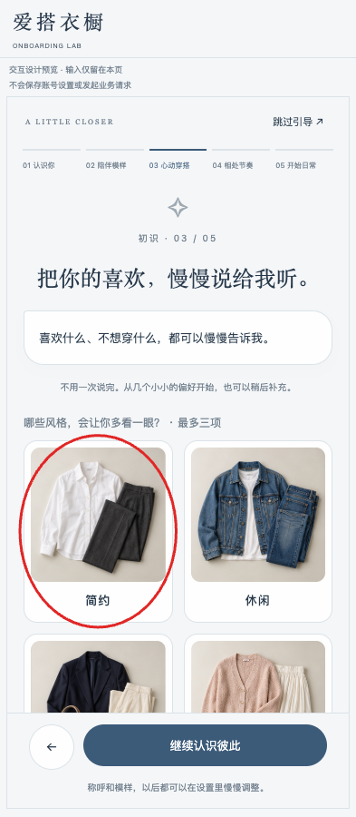

### 男性用户 Onboarding 最终效果

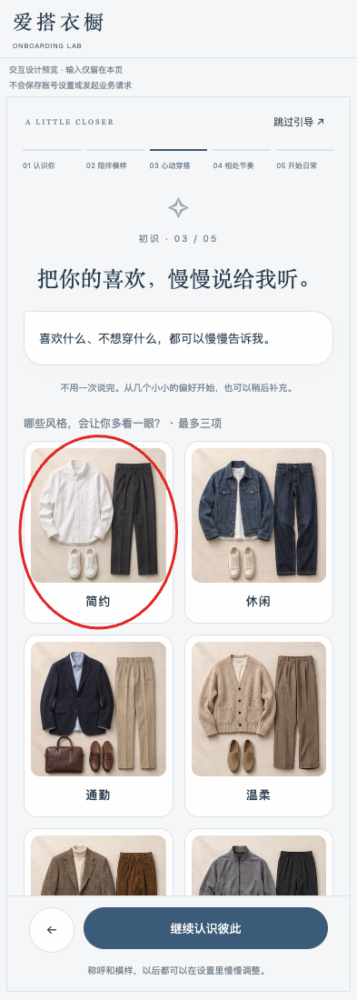

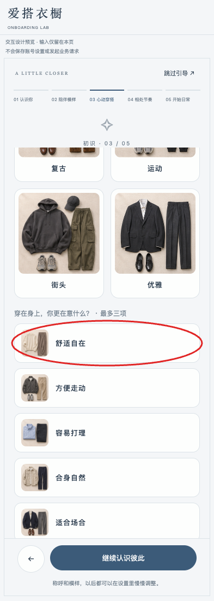

### 男性用户 设置 最终效果

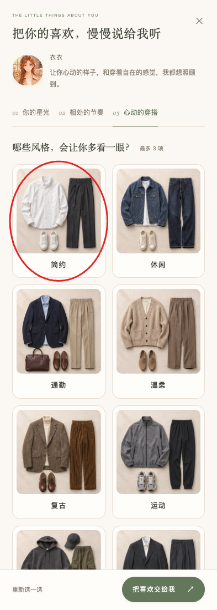

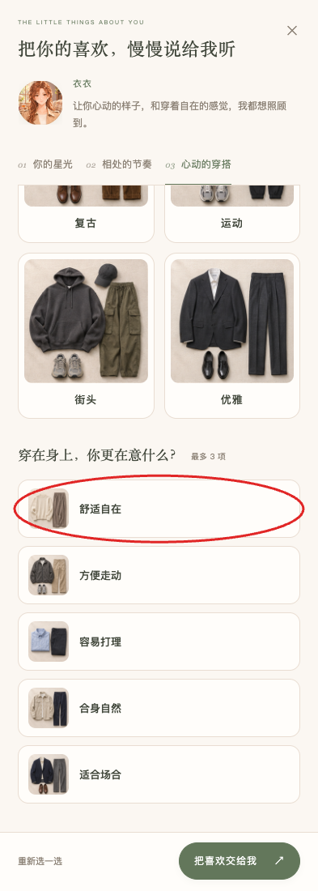

### 女性用户 Onboarding 最终效果

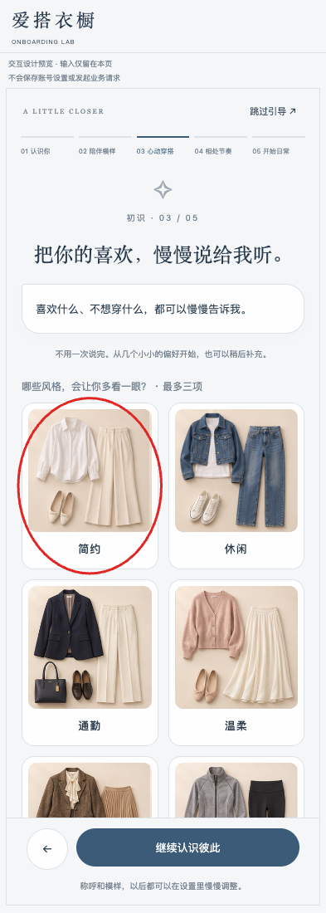

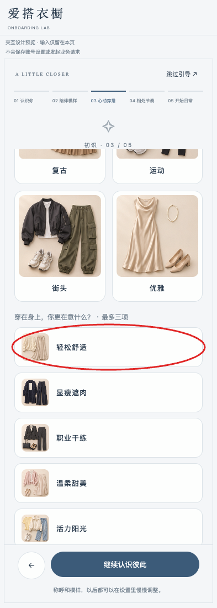

### 女性用户 设置 最终效果

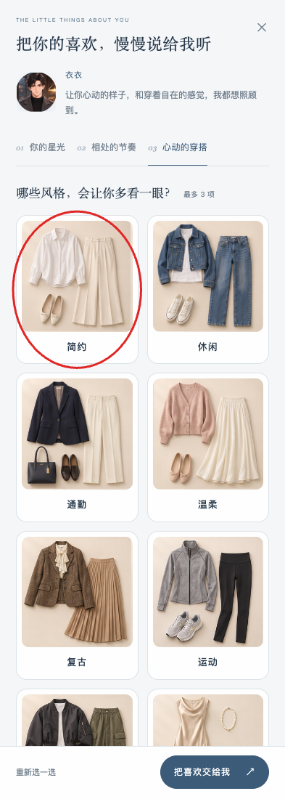

## UI-019 首页单行助理提示与城市天气

- 日期：2026-11-04
- 状态：本地已实现；先截原文案前图登记，再接入并补后图。
- 修改前：首页底部跟随600条预制文案中的invitation字段。
- 修改后：只替换底部文案来源；未选城市显示六位助理各自的一句简短穿搭提示。有城市且已登录时，调用既有带身份天气接口，固定一行「城市 · 天气 · 温度」，不加第二行提醒。
- 数据：当天日期按Asia/Shanghai；展示当日天气预报和最低／最高温，不冒充实时观测。十分钟本页账号／城市／日期隔离缓存；换城市和换号丢弃迟到响应，不自动定位或发送对话。
- 失败：显示「城市 · 天气暂未取到」，不展示旧城市天气或虚构温度；无可用城市时仍显示助理提示。签到保持靠右。
- 验证：Chrome六角色提示不同、带身份当天请求、三要素单行、缓存、失败、迟到响应、账号隔离和320／393／844px对齐模拟通过。截图天气为模拟数据，不代表真实气象接口或GPS验收。

| 助理 | 未选城市时的小提示 |
| --- | --- |
| 甜美机灵 | 舒服打底，再添一点小巧思呀。 |
| 温柔坚定 | 先选穿着舒服的，再慢慢搭配。 |
| 高傲自信 | 选一处亮点，让搭配更利落。 |
| 浪漫灵动 | 留一点色彩，给今天添些新意。 |
| 冷静可靠 | 先定主色，再理清搭配层次。 |
| 笃定不羁 | 挑你喜欢的，穿得自在就好。 |

修改前：

修改后 未选城市：

修改后 城市天气温度：

接口失败：

