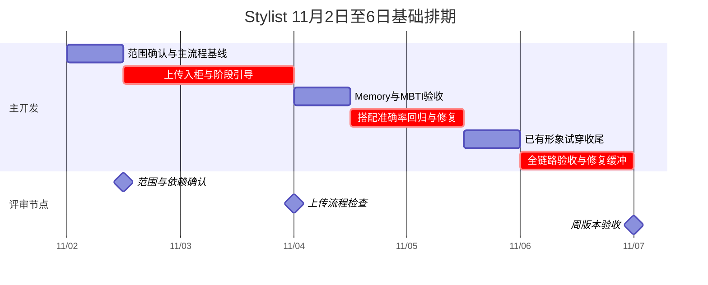

# Stylist 下周工作计划与甘特图

计划周期：2026-11-02 周一至 2026-11-06 周五，Asia/Shanghai。核对日期：2026-10-31。

Word 审阅版：[下周工作计划与甘特图](Stylist下周工作计划与甘特图20261102.docx)，包含可编辑甘特图、每日安排和验收条件。

范围按当前 Stylist 工作区估算，Agent、Server 和 iOS 作为能力与交互参考。本轮只核对实现、运行模拟回归并制定计划，不执行功能开发、真实模型、生图、支付或部署。

**先复用已实现的自动喜恶记忆、MBTI 和试穿主体，下周优先完成上传入柜到继续搭配的流程、准确率回归及现有试穿收尾。** 来源实验、相似款购买及视觉探索要安排明确的时间上限，不把探索结果写成已完成能力。

人力信息尚待确认，基础排期暂按 1 名主开发、每天 8 小时、共 40 小时估算。产品评审和测试账号准备需要相关同事配合，未假定存在第二名全职开发。以下工时是范围受控的计划估算，不是交付保证；周一冻结范围后再确认。

## 当前实现核对

| 用户事项 | 当前状态 | 已有能力 | 下周真正需要做的部分 |
| --- | --- | --- | --- |
| 跑通 Agent 主要流程 | 部分实现，待整体验收 | 登录、天气、个人衣橱搭配、连续修改、历史、偏好及手记均有流程 | 固定主路径验收清单，核对真实环境、失败恢复、手机和 PC |
| 产品引导与提示 | 已有基础，上传引导待补 | 欢迎页、快捷提问、设置引导、message 通知、签到引导 | 梳理空衣橱、上传处理中、上传成功后继续搭配及试穿缺形象等状态，不重建通知组件 |
| 上传衣服并抠图入柜 | Stylist 待实现，Server 有现成能力 | `product_add`、`product_upload_status`，Server 复用审核、分割或抠图、分类与归档 | 图片输入、明确入柜动作、进度卡、幂等与恢复、容量不足提示、完成后更新候选并继续搭配 |
| 自动提炼对话喜恶进入 Memory | 本地已实现，泛化表现待验 | 明确本人“喜欢／不喜欢”等保守提取、去重、持久化、快照及请求重放处理 | 验收隐含与歧义边界、拒绝保存、临时要求、相反偏好及下一轮实际选款；不重新开发基础存储 |
| 日记式完善画像 | 手记基础已实现，日记体验待定义 | “日常片段”等分类，可添加、编辑、删除及暂停 | 下周先定义轻量日记提问和保存边界；完整按日期组织、时间线和画像归纳另排开发 |
| MBTI 等画像选项 | 本地已实现 | 16 型选择、清空、保存、双主题插画及请求资料传递 | 做保存、切账号及真实回复验收，不重新开发选择器；不据 MBTI 推断穿衣偏好 |
| 搭配逻辑与准确率 | 有规则与回归，效果需持续改进 | 天气、禁穿、偏好、局部冻结、真实库存、多日日期与候选不足处理 | 建立固定样本基线，优先修复具体错误，区分硬约束与主观审美 |
| 系统库或直接 AI 生图策略 | 待独立评估 | 当前运行时强制只用个人衣橱；旧系统库分支不能被参数重新启用 | 隔离比较个人衣橱、系统库和 AI 概念图，形成决策；下周不承诺直接替换主流程 |
| 相似款搜索与购买链接 | 有部分底层线索，没有完整可交付链路 | Server 有图搜维护服务，系统商品模型存在 `item_url` | 核对可调用的检索接口、返回商品与链接覆盖率；先判断能否做，不承诺电商购买闭环 |
| 黄色系 App 视觉融合 | 新方向待实施 | Stylist 已有男女角色主题；iOS 2.0 各模块也并非只有黄色 | 选定具体黄色版页面作基准，先调整核心组件方案，不把某个模块颜色当作全 App 基线 |
| 男女助理形象优化与多版头像 | 已有形象，新版本待生成评审 | 男女角色及头像展示入口存在 | 建议各出 2 个静态头像方向供选，先定专业亲切的风格，不扩成全套动态形象重制 |
| 数字人试穿 | 整套主体已实现，结果与真实链路待验 | Stylist 有报价、明确确认、保存搭配及试穿提交；Server 有数字分身能力 | 优先完善已有形象的结果展示、进度及恢复；从照片创建数字分身另计范围 |
| 甘特图与团队对齐 | 本轮整理 | 本文与下方甘特图 | 周一确认负责人和依赖，周三检查，周五按证据验收；本文未代发团队消息 |

本轮已执行：`tests/test_memory.py`、`tests/test_preferences.py`、`tests/test_wardrobe_only.py`、`tests/test_images.py`、`tests/test_partial_wardrobe.py`，共 **123 项通过**，耗时约 2.65 秒。均为模拟外部服务与临时数据库，不证明真实模型、上游服务或扣退积分效果。

## 一名主开发的基础甘特图

图按上午、下午划分工作块，每半天估算 4 小时；条带跨度表示排期，不代表夜间持续工作。周五保留整天用于整体验收、问题修复和交付记录。

| 日期 | 上午 | 下午 | 当天交付 |
| --- | --- | --- | --- |
| 周一 11/02 | 确认范围、账号和环境，跑主流程基线；冻结上传与试穿契约 | 单张图片输入、预览、明确入柜操作、固定 MCP 提交 | 问题清单和可提交上传的开发版本 |
| 周二 11/03 | 上传任务轮询、抠图结果卡、完成后继续搭配 | 账号隔离、幂等、刷新恢复、容量不足和失败提示 | 单张上传入柜到继续搭配的最小完整流程 |
| 周三 11/04 | 验收自动喜恶、MBTI、手记生效和冲突；整理日记提问方案 | 用固定样本检查搭配，归因首批问题 | 已有画像能力验收表、搭配错误分类 |
| 周四 11/05 | 修复高优先级搭配错误，复跑同一批样本 | 已有形象试穿结果展示、处理中与失败状态、未知结果恢复核对 | 搭配前后对照、试穿可演示结果链路或明确阻塞记录 |
| 周五 11/06 | 手机与 PC、男女助理、跨账号、上传到搭配到试穿的整体回归 | 高优先级问题修复、缓冲和交付评审 | 验收记录、未完成项、下一阶段范围；发布另按授权执行 |

工时分配：基线与范围 4h，上传及引导 12h，Memory／MBTI 验收与日记方案 4h，搭配回归修复 8h，现有形象试穿收尾 4h，周五验收和修复缓冲 8h，总计 40h。若上传或试穿涉及上游契约变更，这一估算需要重排。

## 其余事项的探索排期与额外工时

以下完整保留用户目标，但不占用上方已排满的单人 40h。若有产品、设计或第二名开发配合，可在下周并行；若只有一人，则先保证基础流程，相关事项顺延至下一周，或由周一评审明确替换基础任务。

| 事项 | 建议时间窗口 | 估算额外工时 | 负责人类型与交付 |
| --- | --- | --- | --- |
| 个人衣橱、系统库、AI 概念图对照 | 周一确认问题，周三收敛 | 4 至 8h | 产品与算法／后端；同一组场景的对照表、库存缺口和来源建议 |
| 相似款与购买链接可行性 | 周三至周四 | 2 至 4h | 后端；接口可用性、候选对应关系、链接有效性及是否进入开发 |
| 黄色系融合方案 | 周一收参考，周二评审 | 4 至 8h | 设计／前端；首页、搭配卡、上传卡和费用弹窗的共同规范与关键画面 |
| 男女助理静态头像候选 | 风格确定后，周三至周四 | 2 至 4h | 设计／产品；建议男 2 版、女 2 版，选定方向；不含动画和全身图重制 |

基础计划加上述探索合计约 **52 至 64 小时**，一人五天无法同时完成。各项探索若要进入生产实现，还会新增开发与验收工时。

完整日记时间线、照片生成数字分身的前后端流程、相似款购买功能、全量黄色主题改造及头像动画替换，本次均不承诺在五天内全部交付。先在周三评审中确定是否进入后续迭代，避免“基础能力已有”被误认为“完整体验已验收”。

## 搭配来源对照的决策方法

三种来源解决的问题不同，不能仅按图片好看与否比较：

- 个人衣橱：重点是用户确实拥有、能立即穿的衣物组合。
- 系统单品库：重点是已发布商品的覆盖、属性与真实图片，是否有可用购买链接需要单独核对。
- 直接 AI 生图：先按概念参考评价风格表达；生成出来的衣服不能声称是用户已有单品或有货商品。

建议先固定 8 个场景，覆盖通勤、休闲、雨天、低温叠穿、禁穿、本人偏好、局部冻结和候选不足，避免每种来源使用不同问题。硬约束是否违反逐条记录，审美与解释由同一评审人打分；另外记录延迟、费用、商品可追溯性和可购买性。

本轮不执行真实模型或收费图片实验。下周执行时分别明确文字模型、生图及试穿费用。若系统库不足，先区分属性缺失、分类不足与图片质量，再选择补商品、完善属性或提供明确标注的概念参考，不能静默绕过真实库存与禁穿要求。

当前运行时仍保持个人衣橱策略。本次排期授权的是分析与计划，没有恢复系统库或直接生图主流程。

## 各项验收口径

| 工作项 | 最低验收要求 |
| --- | --- |
| 主流程 | 登录、天气、搭配、局部修改、历史恢复均有明确结果；失败可恢复，不把错误当成功 |
| 上传与引导 | 上传前能确认目标，处理中有状态；完成后显示真实单品和抠图，可继续搭配；重复、刷新和切账号不会误入柜或串结果 |
| 容量 | 以实际账号权益为准；本轮测试库非会员个人容量 300 件，会员保护阈值 3000、系统单品独立上限 222，不再沿用初始化 2000 的说法 |
| Memory | 普通对话明确本人喜恶能实际落库，拒绝、临时要求、他人陈述不误存；新请求可应用，当前要求优先；相反偏好当前会追加，需明确本周处理方式 |
| 日记方案 | 定义入口、提问频率、保存前后状态和用户可管理范围；不能把已有手记风格等同于按日期的日记产品 |
| MBTI | 16 型选择、清空、保存及账号隔离正常；不把类型当作穿衣事实或性格诊断 |
| 准确率 | 同一组样本修复前后对照；先看禁穿、库存真实性、冻结和日期等硬约束，不承诺尚无依据的整体百分比 |
| 试穿 | 报价目标一致，取消不提交、重复确认不重复生成；真实结果与处理中、失败、结果未知分开；实际扣退积分另有证据 |
| 视觉与头像探索 | 以用户指定黄色版参考为准，手机与 PC 不割裂；男女形象分别评审，候选获选后再替换，历史和动画资源不顺带重做 |
| 相似款探索 | 有真实候选及可验证链接才宣称可购买；无链接或失效如实显示，生成图不能虚构商品链接 |

上传与试穿被提出用于提升付费和留存，但目前没有效果数据。可先定义上传完成率、入柜后继续搭配率、试穿点击与确认等观测口径；新增正式埋点或收益目标另行确认，不在本轮计划中宣称增长。

## 依赖与调整规则

周一需要确认：主开发人力、非会员与会员测试账号、上游版本和上传 MCP 发布情况、默认试穿形象、积分余额及真实生成测试方式、黄色 App 参考页面、产品与设计评审人。

- 上传接口周一不可用：保留单张输入与状态机开发，输出真实阻塞，不用 Mock 代替联调验收；把上游恢复列为关键依赖。
- 准确率问题较多：优先真实库存、禁穿、日期和局部冻结，减少视觉探索范围，不压缩周五回归。
- 试穿环境未就绪：完成状态与恢复实现，真实扣退积分及质量验收顺延并明确记录，不能标整体验收通过。
- 只有一人且要求所有探索同时完成：调整交付日期或明确替换已有工作块，不将并行条带当作额外人力。
- 超出当前工作区和项目边界的 iOS／Server 改动：单独明确负责人和同步范围，不默认本计划已授权改动其他仓库。

团队对齐建议采用三个节点：周一范围会确认承诺项和依赖，周三看上传演示与中期风险，周五按验收记录评审。未指定收件人或渠道，本轮仅提供可供对齐的计划，不向团队发送消息。

## 代码与证据入口

- 自动记忆：[memory.py](../stylist/memory.py)、[engine.py](../stylist/engine.py)、[test_memory.py](../tests/test_memory.py)、[长记忆说明](LONG_TERM_MEMORY.md)。
- MBTI 与画像：[models.py](../stylist/models.py)、[preferences.js](../stylist/static/preferences.js)、[test_preferences.py](../tests/test_preferences.py)。
- 手记当前结构：[memory.js](../stylist/static/memory.js)；`MemoryEntry` 当前没有日期字段，不能称为完整日记时间线。
- 个人衣橱策略：[retrieval.py](../stylist/retrieval.py)、[test_wardrobe_only.py](../tests/test_wardrobe_only.py)。
- 试穿主体及前端结果：[images.py](../stylist/images.py)、[app.js](../stylist/static/app.js)、[test_images.py](../tests/test_images.py)。
- 上传与商业化接口及数据库只读证据：[商业化分析](STYLIST_MONETIZATION_ANALYSIS.md)。
- 系统商品购买链接字段：[Server 商品响应](../../aicloset-server/internal/controller/product/response.go)；存在 `item_url` 字段不证明当前商品都有有效购买链接。
- iOS 视觉核对：[AgentAppearance.swift](../../../ios/aicloset-IOS/AICloset/Sources/Module2.0/Agent/AgentAppearance.swift)、[ProfileAppearance.swift](../../../ios/aicloset-IOS/AICloset/Sources/Module2.0/Profile/ProfileAppearance.swift)。这些模块含紫粉和冷色，黄色参考页面需周一单独确认。
