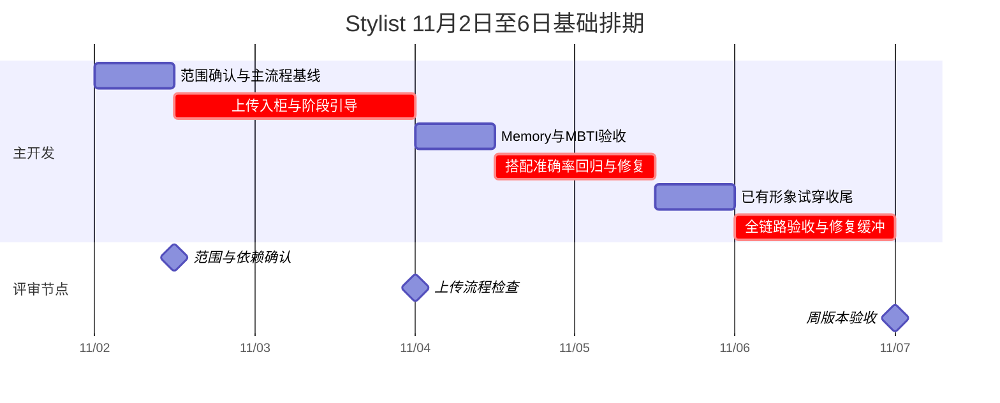

# Stylist 下周工作计划与甘特图

计划周期：2026-11-02 周一至 2026-11-06 周五，Asia/Shanghai。最新计划核对日期：2026-11-02；下方原始工时估算形成于2026-10-31。

Word 审阅版：[下周工作计划与甘特图](Stylist下周工作计划与甘特图20261102.docx)，包含可编辑甘特图、每日安排和验收条件。

范围按当前 Stylist 工作区估算，Agent、Server 和 iOS 作为能力与交互参考。本轮只核对实现、运行模拟回归并制定计划，不执行功能开发、真实模型、生图、支付或部署。

**当前以11月2日截图的21项计划为准。** 上传入柜/继续搭配、六角色及系统配色已有本地实现；优先收尾真实流程、准确率、等待体验与跨端验证。来源扩展、购买链接、评分和商业化新增项仍需分别定义边界，不把探索写成已完成。

10月31日原基础排期按1名主开发、每天8小时、共40小时估算，保留在后文作历史参考。11月2日截图增加和调整了事项；本轮不据原估算承诺21项均可按时完成，人员、跨团队依赖和新增范围需由排期方确认。

## 11月2日截图计划：当前TODO与后续优化

来源：用户于2026-11-02提供的两张计划表截图，转录其中可见的21项；不复制截图中的人员头像或账号信息。任务日期均为2026年，优先级和百分比保留截图值，不由代码核对自行改成100%。5项已完成、3项进行中、13项未开始；原始40小时排期与Word为历史估算，不据此覆盖用户新计划，也不在本轮重制Word。

分析页：[同级Agent能力对比与Stylist TODO](../stylist/static/agent-comparison.html#stylist-todo)。设计总览同步摘要、全量任务说明及当前12章PRD。

当前实现已有六人格、MBTI与服饰图卡、自动明确穿搭喜恶手记、上传入柜/继续搭配、数字人/试穿及系统配色。上传和试穿尚需真实完整链路收尾；各1次dev图片生成是有限证据，非生产/退款/真机全量验收。系统库现按2026-11-03新增「邂逅新衣」授权规则本地接入，真实可用性待验；评分T17已于2026-11-04按用户授权接入点赞软风格参考，详见docs/OUTFIT_FEEDBACK.md；海外天气、购买链接、充值/会员与跨端重设计属于待评估或待实现。

截图头像任务的开始日期为11/02、结束日期为10/31，存在倒序，保留原值待排期方校正。截图成本任务写“1—7件”，现有70次文字成本样本按“1—7套”统计；套数和每套单品件数不得混用。UI中“手账”统一对应现有“我们的手记”，不新增第二套记忆系统。

本轮仅整理计划与研究页面，不实现这些TODO，也不执行真实收费、App改造、发布或外部计划表写入。

| 编号 | 类别 / 任务 | 截图日期 | 优先级 | 截图进度 | 当前实现 | 后续优化 | 验收条件 |
| --- | --- | --- | --- | --- | --- | --- | --- |
| T01 | 搭配准确率完善：【重点】调优搭配准确率，梳理整体搭配逻辑 | 11/03—11/04 | P0 | 0% · 未开始 | 已有库存、天气、禁穿、偏好及冻结校验；检索覆盖与主观审美仍需优化。 | 固定同一批场景与真实候选证据，区分召回不足、属性错误、约束冲突与审美偏差；优先检查150件检索上限。 | 逐例记录原输出、根因、改后输出；硬约束违规率与人工审美评分分开统计。 |
| T02 | 搭配准确率完善：修复本周复现的阻塞问题，扩充对话测试用例，完善交互细节 | 11/06 | P1 | 0% · 未开始 | 已有对话题库、模拟回归和必要范围真实文字记录；不是新建测试体系。 | 归并本周真实复现问题，补原话及前置多轮；覆盖移动端焦点、失败重试和状态恢复。 | 每个阻塞问题能复现、定位并定向复测；保留未通过项，不以选择性复测冒充全量通过。 |
| T03 | 搭配准确率完善：分析已选择男性但仍搭配女性衣服的问题（可能是标签异常） | 11/03 | P0 | 本地修复与定向回归完成，真实验收待补 | 11/03定位为Agent丢失gender与校验缺失，已修复并通过205项必要模拟回归；真实源标签是否另有异常仍待带身份核对。 | 分别核对用户性别、助理性别、当轮穿着对象、商品性别标签、召回过滤与历史条件；中性衣物不能仅凭外观判错。 | 保存脱敏商品证据与最小复现；本人/他人/切角色/未知及中性标签均有回归，不让助理性别覆盖对象。 |
| T04 | 交互体验功能增加：增加MBTI等性格维度选项以丰富用户画像 | 10/31 | P1 | 100% · 已完成 | MBTI选择、取消、保存、插画与请求快照已实现。 | 重点验收保存刷新、切账号和本人/他人请求边界；不重复开发，不将MBTI用于诊断或推断穿衣喜好。 | 16型与清空可用，失败保留草稿，旧账号迟到响应不污染新账号。 |
| T05 | 交互体验功能增加：“了解我—心动穿搭”模块配图 | 10/31 | P1 | 100% · 已完成 | 8项风格、5项优先因素已有写实服饰/物件图卡。 | 复核图义与文案一致、最多3项、主题和窄屏布局、图片加载失败及无障碍名称。 | 桌面/320/390px可用；选中与取消准确，图片不替代选项文字。 |
| T06 | 交互体验功能增加：优化男女助理形象，生成多版头像供选择，使用正常成人比例 | 截图：11/02 → 10/31* | P1 | 100% · 已完成 | 六位透明立绘、独立人格、首页眨眼和静态头像已接入。 | 继续核对所选角色在首页/对话/天气/加载/来信的一致性，复测眼外静止与减少动态；不重新生成整套素材。 | 六角色映射及账号隔离正确；真人检查辨识度与成人比例。*截图结束日期早于开始日期，保留原值，待排期方校正。 |
| T07 | 交互体验功能增加：增加“我们的手账/手记”引导（Memory） | 11/04 | P0 | 0% · 未开始 | 穿搭手记管理和明确喜恶自动保存已实现；引导与日期日记不是同一功能。 | 解释会记什么、在哪里查看/改删/暂停；适时提供可跳过的引导，不扩大为日常生活日记或隐式人格画像。 | 不阻挡搭配；拒绝不保存，真实提交成功才报已记住；重复引导频率有明确规则。 |
| T08 | 交互体验功能增加：探索AI生成或系统库单品的相似款搜索/购买链接 | 11/04 | P1 | 0% · 未开始 | 当前运行时仅个人衣橱；相似款与有效购买链接尚无完整闭环。 | 只读核验可用图搜/属性检索、返回商品身份、链接覆盖率与有效性；区分概念图、已有库存和可购买商品。 | 交付可行性结论与有依据的样本，不编造链接、不自动购物；系统源启用另行确定。 |
| T09 | 交互体验功能增加：对接后端，寻找支持国外天气的第三方接口 | 11/06 | P2 | 0% · 未开始 | 已有城市天气链路；未在本轮确认海外城市/时区的真实覆盖。 | 先明确目标国家城市、地名解析、当地日期与预报窗口，再评估接口契约、配额和降级方式。 | 用指定海外城市验证日期/单位/时区与缺失字段；接口方案待核对，不在本报告推荐未研究的供应商。 |
| T10 | 商业化部分：付费点集成：整套试穿、个人数字分身、衣物补全/美化、积分充值、会员购买/续费与容量升级 | 11/05 | P0 | 0% · 未开始 | 试穿和分身已有接口、费用确认及有限dev生成样本；补全/美化、充值/会员/扩容没有同等H5闭环。 | 拆成复用能力验收、可跳转入口、待新增能力三组；核对每项报价/权益/回执/未知状态，避免一项“集成”掩盖多项工作。 | 确认后才产生业务效果；积分与人民币分开；取消、重复、失败退款、权益到账分别验证，真实收费另按授权执行。 |
| T11 | 商业化部分：测算搭配1—7档Token成本、试衣成本及生成时间并制表 | 11/02 | P0 | 100% · 已完成 | 已有70次真实文字样本和分身/试穿各1次dev耗时记录；图像人民币成本仍含预算假设。 | 把单品件数与搭配套数分开：现有70次文字样本按1—7套；注明模型usage、预算、积分与供应商实账的区别。 | 保留失败样本与P50/P90；真实衣橱检索、前端抠图及用户等待不能被模型耗时冒充；供应商实账未校准。 |
| T12 | 用户体验及速度优化：持续优化对话加载、搭配速度并缩短用户等待 | 11/03—11/06 | P0 | 0% · 未开始 | 已有阶段进度、请求恢复、文字耗时样本与部分组合图缓存。 | 分段测理解/天气/召回/生成/修复/抠图/上传/试穿；区分首个有效反馈和完整结果，按瓶颈优化并保持事实校验。 | 同场景同配置前后对照P50/P90、失败率与成本；不靠假百分比或删费用确认制造“更快”。 |
| T13 | 主流程完善：从对话自动提炼明确偏好并存入手记，而非必须使用记忆指令 | 10/31 | P0 | 100% · 已完成 | 本人明确稳定的穿搭喜恶已自动提炼；当前记忆范围仅穿搭。 | 验收并列喜恶、否定、转述、临时条件、他人信息、拒绝保存及保存后下一次选款。 | 不把隐含猜测存为事实，不保存饮食或关系约定；事务成功后回执与历史一致。 |
| T14 | 主流程完善：【重点】引导用户上传衣服，经抠图处理入柜，以提升付费和留存 | 11/02 | P0 | 80% · 进行中 | 本地预览/明确上传/正式入柜/单品继续搭配及对话意图卡已接入；截图整体进度80%。 | 收尾真实抠图识别、容量不足、超时丢回执、历史恢复、真机与上传后搭配；保持仅用户表达入柜意图才邀请，不因候选少强推。 | 完成图与真实单品ID一致；不重复入柜，跨账号不串数据；付费与留存提升另需用户数据证明。 |
| T15 | 主流程完善：默认个人衣橱，邂逅新衣允许系统参考款 | 11/03 | P0 | 本地已实现 · 真实另验 | 用户已确定手动开关、明确意图自动开启及缺衣双入口卡，替代原待评估策略。 | 实现授权校验、六人格message、来源展示及账号／会话隔离，见NEW_CLOTHES.md。 | 不冒称已拥有；旧source不能绕过；真实源标签、接口、购买及付费试穿分开验收。 |
| T16 | 主流程完善：集成数字人试穿，消耗积分生成数字人并结合穿搭 | 11/02—11/03 | P0 | 80% · 进行中 | 人物选择、照片检查/生成/采用、试穿确认与结果恢复已实现；有dev各1次小样，截图整体80%。 | 补本人照片/默认形象变化/无可用分身/低余额/报价失效/断网未知/失败退款/真机全链路验收。 | 人物生成与整套试穿分别确认；不重复扣费；成功须真实图，退款须真实回执；照片主体身份验证尚未实现。 |
| T17 | 主流程完善：搭配评价与风格参考 | 11/04 | P1 | 本地已实现，真实模型待验 | 喜欢／不喜欢、按版本保存、纠正撤回及点赞软参考已接入。 | 账号隔离、重复去重、暂停与Agent载荷模拟回归；真实模型效果另验。 | 不从低分推断永久禁忌，不覆盖明确要求，不自动生成或收费。 |
| T18 | 主流程完善：参考现有功能，跑通Agent主要功能整体流程 | 11/05 | P0 | 0% · 未开始 | 主要模块本地可用；模块回归不等于真实完整用户流程已验收。 | 以登录→城市→衣橱/上传→搭配→修改→形象→费用确认→结果/历史恢复串联；加切账号、离线和取消。 | 每阶段记请求/状态/真实回执和阻塞点；区分合成、真实只读、写入/收费证据，失败不能用mock替代宣称通过。 |
| T19 | 主流程完善：实现一个App内示例，正常运行改版后的Agent（尽快） | 11/03—11/06 | P1 | 0% · 未开始 | 已有Web页面；本轮未核对App内嵌示例的实现与验收。 | 定义登录态传递、路由/返回、图片选择/权限、跨域及接口域名、支付跳转与回流；沿用明确确认边界。 | 在约定真实App与手机版本上贯通主路径；浏览器窄屏截图不能替代原生容器验收。 |
| T20 | UI一致性变更：融合现有黄色系App UI，避免视觉割裂 | 11/02 | P0 | 90% · 进行中 | 系统黄白配色已正式接入、按账号保存；截图整体进度90%。 | 集中验收三主题全部弹窗/状态/图片/焦点和App衔接；保持人物与人格不被系统色切换覆盖。 | PC/手机/横屏无溢出；颜色切换与取消回滚正确；真机检查，剩余10%不能由代码自判完成。 |
| T21 | UI一致性变更：造型册、Agent首页、个人中心按既有逻辑重新设计 | 11/02—11/03 | P1 | 0% · 未开始 | 已有爱搭衣橱首页；造型册/个人中心的跨端整体重设计不等于本地配色完成。 | 先画信息结构和入口关系，核对登录、衣橱/搭配列表、设置和生成记录；分清App与Stylist职责，复用既有业务。 | 先交关键页面与状态流评审稿，再安排实现；覆盖空态、长内容、失败、主题与真机，不因改版引入重复功能。 |

以上用户计划优先于下方旧估算；计划日期不是本轮交付承诺。商业化与系统源扩展必须先定义边界，现有硬性限制、账号隔离、用户确认及费用授权继续生效。

## 10月31日原始实现核对（历史快照，现状以上方11月2日更新为准）

| 用户事项 | 当前状态 | 已有能力 | 下周真正需要做的部分 |
| --- | --- | --- | --- |
| 跑通 Agent 主要流程 | 部分实现，待整体验收 | 登录、天气、个人衣橱搭配、连续修改、历史、偏好及手记均有流程 | 固定主路径验收清单，核对真实环境、失败恢复、手机和 PC |
| 产品引导与提示 | 已有基础，上传引导待补 | 欢迎页、快捷提问、设置引导、message 通知、签到引导 | 梳理空衣橱、上传处理中、上传成功后继续搭配及试穿缺形象等状态，不重建通知组件 |
| 上传衣服并抠图入柜 | Stylist 待实现，Server 有现成能力 | `product_add`、`product_upload_status`，Server 复用审核、分割或抠图、分类与归档 | 图片输入、明确入柜动作、进度卡、幂等与恢复、容量不足提示、完成后更新候选并继续搭配 |
| 自动提炼对话喜恶进入 Memory | 本地已实现，泛化表现待验 | 明确本人“喜欢／不喜欢”等保守提取、去重、持久化、快照及请求重放处理 | 验收隐含与歧义边界、拒绝保存、临时要求、相反偏好及下一轮实际选款；不重新开发基础存储 |
| 日记式完善画像 | 手记基础已实现，日记体验待定义 | 穿搭手记可添加、编辑、删除及暂停；最新规则已移除日常片段分类 | 后续先做穿搭手记引导；日期日记、时间线和画像归纳仍待定义，不扩大当前穿搭保存范围 |
| MBTI 等画像选项 | 本地已实现 | 16 型选择、清空、保存、双主题插画及请求资料传递 | 做保存、切账号及真实回复验收，不重新开发选择器；不据 MBTI 推断穿衣偏好 |
| 搭配逻辑与准确率 | 有规则与回归，效果需持续改进 | 天气、禁穿、偏好、局部冻结、真实库存、多日日期与候选不足处理 | 建立固定样本基线，优先修复具体错误，区分硬约束与主观审美 |
| 系统库或直接 AI 生图策略 | 待独立评估 | 默认个人衣橱；邂逅新衣已本地接入，旧source参数仍不能绕过授权 | 隔离比较个人衣橱、系统库和 AI 概念图，形成决策；下周不承诺直接替换主流程 |
| 相似款搜索与购买链接 | 有部分底层线索，没有完整可交付链路 | Server 有图搜维护服务，系统商品模型存在 `item_url` | 核对可调用的检索接口、返回商品与链接覆盖率；先判断能否做，不承诺电商购买闭环 |
| 黄色系 App 视觉融合 | 新方向待实施 | Stylist 已有男女角色主题；iOS 2.0 各模块也并非只有黄色 | 选定具体黄色版页面作基准，先调整核心组件方案，不把某个模块颜色当作全 App 基线 |
| 男女助理形象优化与多版头像 | 已有形象，新版本待生成评审 | 男女角色及头像展示入口存在 | 建议各出 2 个静态头像方向供选，先定专业亲切的风格，不扩成全套动态形象重制 |
| 数字人试穿 | 整套主体已实现，结果与真实链路待验 | Stylist 有报价、明确确认、保存搭配及试穿提交；Server 有数字分身能力 | 优先完善已有形象的结果展示、进度及恢复；从照片创建数字分身另计范围 |
| 甘特图与团队对齐 | 本轮整理 | 本文与下方甘特图 | 周一确认负责人和依赖，周三检查，周五按证据验收；本文未代发团队消息 |

本轮已执行：`tests/test_memory.py`、`tests/test_preferences.py`、`tests/test_wardrobe_only.py`、`tests/test_images.py`、`tests/test_partial_wardrobe.py`，共 **123 项通过**，耗时约 2.65 秒。均为模拟外部服务与临时数据库，不证明真实模型、上游服务或扣退积分效果。

## 10月31日原始基础甘特图（历史估算，非最新承诺）

图按上午、下午划分工作块，每半天估算 4 小时；条带跨度表示排期，不代表夜间持续工作。周五保留整天用于整体验收、问题修复和交付记录。

| 日期 | 上午 | 下午 | 当天交付 |
| --- | --- | --- | --- |
| 周一 11/02 | 确认范围、账号和环境，跑主流程基线；冻结上传与试穿契约 | 单张图片输入、预览、明确入柜操作、固定 MCP 提交 | 问题清单和可提交上传的开发版本 |
| 周二 11/03 | 上传任务轮询、抠图结果卡、完成后继续搭配 | 账号隔离、幂等、刷新恢复、容量不足和失败提示 | 单张上传入柜到继续搭配的最小完整流程 |
| 周三 11/04 | 验收自动喜恶、MBTI、手记生效和冲突；整理日记提问方案 | 用固定样本检查搭配，归因首批问题 | 已有画像能力验收表、搭配错误分类 |
| 周四 11/05 | 修复高优先级搭配错误，复跑同一批样本 | 已有形象试穿结果展示、处理中与失败状态、未知结果恢复核对 | 搭配前后对照、试穿可演示结果链路或明确阻塞记录 |
| 周五 11/06 | 手机与 PC、男女助理、跨账号、上传到搭配到试穿的整体回归 | 高优先级问题修复、缓冲和交付评审 | 验收记录、未完成项、下一阶段范围；发布另按授权执行 |

工时分配：基线与范围 4h，上传及引导 12h，Memory／MBTI 验收与日记方案 4h，搭配回归修复 8h，现有形象试穿收尾 4h，周五验收和修复缓冲 8h，总计 40h。若上传或试穿涉及上游契约变更，这一估算需要重排。

## 10月31日其余探索排期与额外工时（历史估算）

以下完整保留用户目标，但不占用上方已排满的单人 40h。若有产品、设计或第二名开发配合，可在下周并行；若只有一人，则先保证基础流程，相关事项顺延至下一周，或由周一评审明确替换基础任务。

| 事项 | 建议时间窗口 | 估算额外工时 | 负责人类型与交付 |
| --- | --- | --- | --- |
| 个人衣橱、系统库、AI 概念图对照 | 周一确认问题，周三收敛 | 4 至 8h | 产品与算法／后端；同一组场景的对照表、库存缺口和来源建议 |
| 相似款与购买链接可行性 | 周三至周四 | 2 至 4h | 后端；接口可用性、候选对应关系、链接有效性及是否进入开发 |
| 黄色系融合方案 | 周一收参考，周二评审 | 4 至 8h | 设计／前端；首页、搭配卡、上传卡和费用弹窗的共同规范与关键画面 |
| 男女助理静态头像候选 | 风格确定后，周三至周四 | 2 至 4h | 设计／产品；建议男 2 版、女 2 版，选定方向；不含动画和全身图重制 |

基础计划加上述探索合计约 **52 至 64 小时**，一人五天无法同时完成。各项探索若要进入生产实现，还会新增开发与验收工时。

完整日记时间线、照片生成数字分身的前后端流程、相似款购买功能、全量黄色主题改造及头像动画替换，本次均不承诺在五天内全部交付。先在周三评审中确定是否进入后续迭代，避免“基础能力已有”被误认为“完整体验已验收”。

## 搭配来源对照的决策方法

三种来源解决的问题不同，不能仅按图片好看与否比较：

- 个人衣橱：重点是用户确实拥有、能立即穿的衣物组合。
- 系统单品库：重点是已发布商品的覆盖、属性与真实图片，是否有可用购买链接需要单独核对。
- 直接 AI 生图：先按概念参考评价风格表达；生成出来的衣服不能声称是用户已有单品或有货商品。

建议先固定 8 个场景，覆盖通勤、休闲、雨天、低温叠穿、禁穿、本人偏好、局部冻结和候选不足，避免每种来源使用不同问题。硬约束是否违反逐条记录，审美与解释由同一评审人打分；另外记录延迟、费用、商品可追溯性和可购买性。

本轮不执行真实模型或收费图片实验。下周执行时分别明确文字模型、生图及试穿费用。若系统库不足，先区分属性缺失、分类不足与图片质量，再选择补商品、完善属性或提供明确标注的概念参考，不能静默绕过真实库存与禁穿要求。

2026-11-03后续用户已授权通过「邂逅新衣」显式入口接入系统参考款，替代此处仅规划不开放的边界；默认仍个人衣橱，直接AI生图、购买和付费试穿另行验收，见NEW_CLOTHES.md。

## 各项验收口径

| 工作项 | 最低验收要求 |
| --- | --- |
| 主流程 | 登录、天气、搭配、局部修改、历史恢复均有明确结果；失败可恢复，不把错误当成功 |
| 上传与引导 | 上传前能确认目标，处理中有状态；完成后显示真实单品和抠图，可继续搭配；重复、刷新和切账号不会误入柜或串结果 |
| 容量 | 以实际账号权益为准；本轮测试库非会员个人容量 300 件，会员保护阈值 3000、系统单品独立上限 222，不再沿用初始化 2000 的说法 |
| Memory | 普通对话明确本人喜恶能实际落库，拒绝、临时要求、他人陈述不误存；新请求可应用，当前要求优先；相反偏好当前会追加，需明确本周处理方式 |
| 日记方案 | 定义入口、提问频率、保存前后状态和用户可管理范围；不能把已有手记风格等同于按日期的日记产品 |
| MBTI | 16 型选择、清空、保存及账号隔离正常；不把类型当作穿衣事实或性格诊断 |
| 准确率 | 同一组样本修复前后对照；先看禁穿、库存真实性、冻结和日期等硬约束，不承诺尚无依据的整体百分比 |
| 试穿 | 报价目标一致，取消不提交、重复确认不重复生成；真实结果与处理中、失败、结果未知分开；实际扣退积分另有证据 |
| 视觉与头像探索 | 以用户指定黄色版参考为准，手机与 PC 不割裂；男女形象分别评审，候选获选后再替换，历史和动画资源不顺带重做 |
| 相似款探索 | 有真实候选及可验证链接才宣称可购买；无链接或失效如实显示，生成图不能虚构商品链接 |

上传与试穿被提出用于提升付费和留存，但目前没有效果数据。可先定义上传完成率、入柜后继续搭配率、试穿点击与确认等观测口径；新增正式埋点或收益目标另行确认，不在本轮计划中宣称增长。

## 依赖与调整规则

周一需要确认：主开发人力、非会员与会员测试账号、上游版本和上传 MCP 发布情况、默认试穿形象、积分余额及真实生成测试方式、黄色 App 参考页面、产品与设计评审人。

- 上传接口周一不可用：保留单张输入与状态机开发，输出真实阻塞，不用 Mock 代替联调验收；把上游恢复列为关键依赖。
- 准确率问题较多：优先真实库存、禁穿、日期和局部冻结，减少视觉探索范围，不压缩周五回归。
- 试穿环境未就绪：完成状态与恢复实现，真实扣退积分及质量验收顺延并明确记录，不能标整体验收通过。
- 只有一人且要求所有探索同时完成：调整交付日期或明确替换已有工作块，不将并行条带当作额外人力。
- 超出当前工作区和项目边界的 iOS／Server 改动：单独明确负责人和同步范围，不默认本计划已授权改动其他仓库。

团队对齐建议采用三个节点：周一范围会确认承诺项和依赖，周三看上传演示与中期风险，周五按验收记录评审。未指定收件人或渠道，本轮仅提供可供对齐的计划，不向团队发送消息。

## 代码与证据入口

- 自动记忆：[memory.py](../stylist/memory.py)、[engine.py](../stylist/engine.py)、[test_memory.py](../tests/test_memory.py)、[长记忆说明](LONG_TERM_MEMORY.md)。
- MBTI 与画像：[models.py](../stylist/models.py)、[preferences.js](../stylist/static/preferences.js)、[test_preferences.py](../tests/test_preferences.py)。
- 手记当前结构：[memory.js](../stylist/static/memory.js)；`MemoryEntry` 当前没有日期字段，不能称为完整日记时间线。
- 个人衣橱策略：[retrieval.py](../stylist/retrieval.py)、[test_wardrobe_only.py](../tests/test_wardrobe_only.py)。
- 试穿主体及前端结果：[images.py](../stylist/images.py)、[app.js](../stylist/static/app.js)、[test_images.py](../tests/test_images.py)。
- 上传与商业化接口及数据库只读证据：[商业化分析](STYLIST_MONETIZATION_ANALYSIS.md)。
- 系统商品购买链接字段：[Server 商品响应](../../aicloset-server/internal/controller/product/response.go)；存在 `item_url` 字段不证明当前商品都有有效购买链接。
- iOS 视觉核对：[AgentAppearance.swift](../../../ios/aicloset-IOS/AICloset/Sources/Module2.0/Agent/AgentAppearance.swift)、[ProfileAppearance.swift](../../../ios/aicloset-IOS/AICloset/Sources/Module2.0/Profile/ProfileAppearance.swift)。这些模块含紫粉和冷色，黄色参考页面需周一单独确认。
